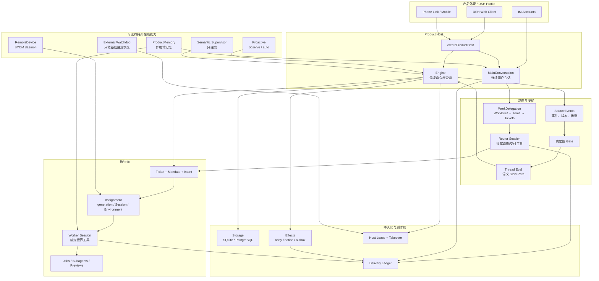
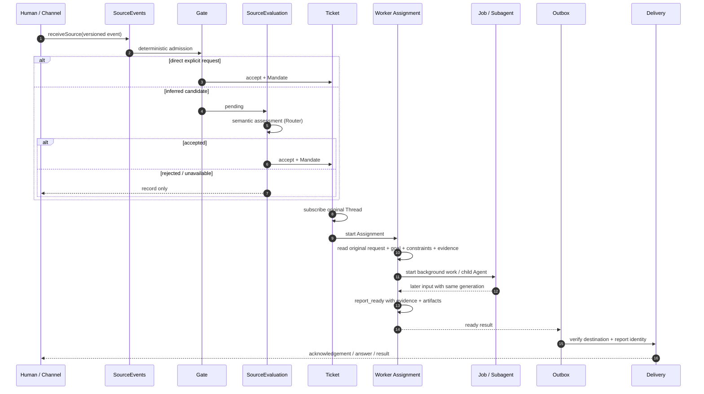
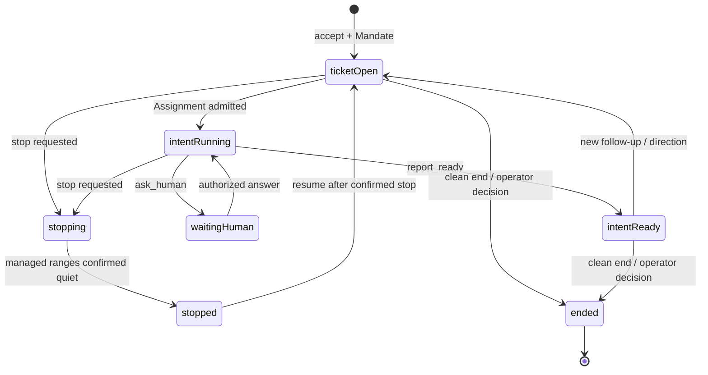
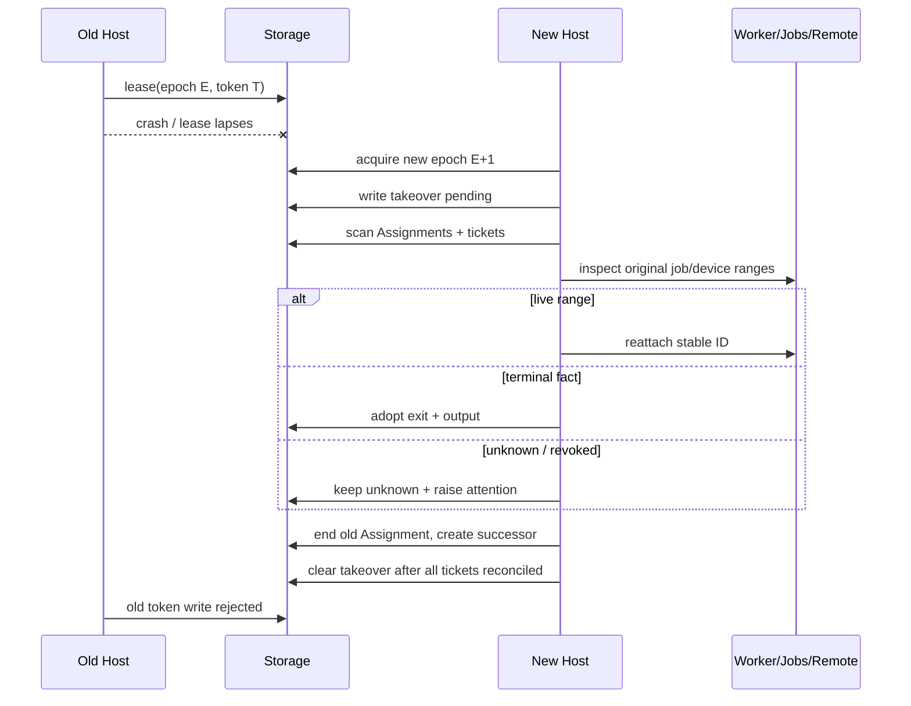

# DS-SuperAgent 领域与运行时审计

日期：2026-11-24  
基线：`dev` / `d03bb434`，工作区已有未提交改动；本次只读检查，未修改产品代码。  
对照材料：`super-agent-references/claude-analysis/superagent-report.md` 第 4、5 节。  
范围：`superagent/src/` 的领域模型、Main/Router/Worker、来源研判、票据与订阅、执行、作业、持久化副作用、恢复、主动工作、监督、记忆、远程环境和来源适配。

## 0. 结论先行

1. **当前实现已经不是报告里的“研究原型”。** 它保留了 Trigger/Thread/Mandate/Ticket 等骨架，但在此之上加了独立的 Main 会话层、WorkBrief/WorkItem 投影、持久化 Effects、Assignment generation fencing、Host lease/takeover、远程执行设备、主动工作、语义 Supervisor 和按作用域授权的长期记忆。
2. **文章最核心的双层思想已经落地，而且实现为三层：Main 负责连续对话，Router 负责把已授权的 Main 请求拆成 durable tickets，Worker 负责隔离执行。** 见 `superagent/src/main-conversation.ts:20`、`superagent/src/work-delegation.ts:38`、`superagent/src/model.ts:65`。
3. **工具隔离比报告原型更强。** 当前每个 DSH Session 先 `tools.restrict({ allow: [] })`，再登记该角色的产品工具；Main/Router/Worker 不再共享一套默认 Bash/文件工具。见 `superagent/src/native-sessions.ts:306`。
4. **可靠性是当前最大的超预期项。** 持久化副作用队列、未知结果禁止盲重放、Ticket/Assignment 代际隔离、Host 租约接管、作业/子代理所有权和远程设备对账均已进入领域层，不是 UI 层补丁。
5. **文章后半段仍未完全闭合。** 云端弹性计算、多活 Router、自动设备上线调度、自动变更提示词/触发规则的 Watchdog、真正长期无损记忆、真实模型/真实频道的完整验收都还没有完成。当前的强项是“本地优先的生产级控制面”，不是“云端常驻的完整 Super-agent 服务”。

我的分层判断：

| 维度 | 判断 | 依据 |
| --- | --- | --- |
| 文章概念覆盖（机制存在且可运行） | **约 79%** | 26 个关键概念中 16 个完整、9 个部分、1 个未见完整实现；评分口径见 §6 |
| 领域与可靠性工程 | **高** | 代码、测试文件和历史故障记录均覆盖；但本次未重跑全量 |
| 产品级外部验收 | **约三分之一** | 仓库历史证据有 GitHub、跨设备、Host/Watchdog 等真实链路，但 Real model、真实 Feishu、托管 Host、组合故障仍未验收 |
| 文章 §7 实验等价证据 | **低** | 当前只有 `dev/collaboration-bench.mjs` 的 mock 等负载对比，没有文章级真实模型/Token 消融实验 |

## 1. 代码规模与证据基线

本次不是按目录名猜测架构，而是先做完整文件清单，再深读核心状态机、命令路径、恢复路径和测试入口。

| 指标 | 当前值 | 口径 |
| --- | ---: | --- |
| `superagent/src/` TypeScript 文件 | 138 | `rg --files superagent/src` |
| `superagent/src/` 行数 | 42,553 | 逐文件统计 |
| 最大模块 | `engine.ts` 4,184 行；`execution.ts` 3,260 行；`product-host.ts` 1,747 行 | 文件行数 |
| Server/Domain 测试文件 | 149 | `superagent/test/*.test.mjs` |
| Server/Domain 测试代码行 | 30,836 | 测试文件总行数 |
| `test(` 调用文本数 | 781 | 静态 grep，不等于 781 个唯一断言 |
| DSH 客户端测试文件 | 48 | `superagent/dsh/test/*.test.js` |
| `superagent/dsh/src/client/` JS | 74 个文件、15,521 行 | 生成前源码 |
| 实现记录 | 65 个 `docs/superagent/implementation/t*.md` | 历史证据索引 |
| 独立 review 记录 | 49 个 | `docs/superagent/implementation/reviews/t*.md` |

证据等级说明：

- **E1**：代码存在，有单元/集成测试入口。
- **E2**：有 mock 端到端或真实进程/设备替身验证。
- **E3**：有真实外部系统、真实第二设备或真实进程故障证据。
- **E4**：真实模型 + 真实频道 + 部署形态的组合验收。

本次为静态代码审计，**没有重跑全量测试**；历史测试数量不能替代当前工作区的通过结果。

## 2. 当前架构分层

### 2.1 分层总览



### 2.2 与文章概念的翻译

| 文章 | 当前实现 | 说明 |
| --- | --- | --- |
| Router | **Main + Router** | Main 是用户面前的连续会话；Router 是内部拆解器 |
| Worker | **Ticket Assignment 的 DSH Session** | 一个 WorkItem 对应一个 Ticket，一个 Ticket 固定一个环境与 Assignment |
| Trigger | **SourceEvent + Work trigger** | SourceEvent 保留来源版本和候选关系；Work trigger 是授权后的不可变工单输入 |
| Thread | **来源定义的 Thread ID** | GitHub、Feishu、Schedule、IM 各自定义 thread |
| Eval | **SourceEvaluation + 语义 assessor** | Gate 先做确定性判定；不确定事件再交 Router 判断 |
| Mandate | **Ticket 的不可变授权快照** | 包含 scope、strength、environment、capabilities |
| Worker subscription | **Ticket ↔ Thread 的多对多订阅** | 订阅主体沿用旧原型的 Ticket 设计，不挂在 Session 上 |
| Worker session | **Assignment** | 可替换、可重试、可交接；有独立 `generation` 语义 |
| Delivery | **Deliveries + Outbox** | acknowledgement / answer / result / attention / policy 都有依据和状态 |

## 3. 当前领域模型

### 3.1 核心对象

`superagent/src/model.ts:65-107` 是最关键的领域快照：

- `Work.trigger`：来源、事件 ID、正文、环境、执行目标、能力、Thread、原生图片、主动上下文、交付原点。
- `Work.decision`：接受决策、政策版本。
- `Work.mandate`：不可变授权；范围来自 WorkItem 的 goal。
- `Work.ticket`：`open | ended`；`directionVersion`；可选 `stopped | waiting-human` 约束。
- `Work.intent`：当前执行投影状态与原因，不直接等同 Session 存活。

记录种类（`recordKinds`）覆盖 Trigger、Decision、Mandate、Ticket、Intent、Command、Event、Effect、Assignment、Report、Delivery、SourceEvent、Subscription、Input、Ownership、Job、Subagent、Host、Takeover、Watchdog、Supervisor、Memory 等（`superagent/src/model.ts:85-106`）。这说明领域事实不是从对话历史反推，而是独立持久化。

### 3.2 MainWorkBrief / WorkItem 与 Ticket 的关系

这是与报告原型最大的结构差异之一。

- Main 的一条消息可以创建一个 `MainWorkBrief`，其中包含原始用户文本、目标、约束、验收标准、附件、执行目标、配置版本。
- Router 必须调用 `establish_work_plan`，把 Brief 拆为 1–4 个 `MainWorkItem`，并为每个 item 建立独立 Ticket。
- 每个 Ticket 的 Mandate scope 是对应 item 的 `goal`；Worker 收到的正文同时包含原始请求、目标、约束和验收标准。

证据：

- Brief/Item/Receipt/Outcome 类型：`superagent/src/work-delegation.ts:38-112`。
- Router 工具 `establish_work_plan`：`superagent/src/work-delegation.ts:703-736`。
- WorkItem 建立 Ticket 时拼接完整请求：`superagent/src/engine.ts:817`。
- Ticket ↔ WorkItem 索引：`superagent/src/engine.ts:859-860`。

这意味着当前系统把“用户对话”与“可执行工单”显式分离：用户不需要管理 Session，但内部保留独立工单身份，Main 可以持续引用、追问、停止或交接。

### 3.3 订阅、输入与所有权

`superagent/src/work-inputs.ts` 是文章 §3.2 的核心实现：

- 订阅主体是 Ticket：`ThreadSubscription { ticketId, threadId, mode: worker | context }`。
- 默认订阅原始 Thread：`WorkInputs.subscribe`（`work-inputs.ts:247-252`）。
- 多对多：一个 Ticket 最多 1000 个订阅，一个 Thread 最多 1000 个订阅（`work-inputs.ts:271-273`）。
- fan-out 对每个订阅目标生成 `WorkInput` 和 `WorkOwnership`；同一事件不会重复生成已有输入（`work-inputs.ts:281-335`）。
- Worker 可以添加相关 Thread、取消自己添加的订阅，或把超出范围的输入 handback（`execution.ts:1665-1717`）。
- 已取消/已 handback 的输入不会自动复活；新的关联必须走新的 ownership 决策。

这是文章“订阅直通”的完整实现，而且比报告原型更强调所有权和幂等。

### 3.4 事件、Gate 与 Thread 级 Eval

`superagent/src/source-evaluations.ts`：

- 确定性 Gate：删除事件、自身消息、未允许 actor、无匹配规则直接拒绝；human direct + explicit 规则直接接受；inferred 规则进入 `pending`（`:213-237`）。
- 每个 Thread 同一时间只有一个 Eval head；后续批次排队（`:279-314`、`:589-632`）。
- 一个 Eval 可接受一批事件，最多 `maxBatchSize`（上限 20）且记录总量有 120 KB、Router 输入有 100 KB 硬预算（`:243-278`）。
- 语义判定失败、超时、暂停、进程重启都会进入明确的 `unavailable`，不会伪装成已拒绝或已完成（`:283-297`、`:375-458`）。
- 语义结果必须逐个 `eventId` 返回；无效/重复结果被丢弃，剩余项记为 `ASSESSOR_UNAVAILABLE` 或 `INVALID_ASSESSMENT`。
- Eval 的 reciept 一旦生成，重放命令会复用原 evaluation，不会重复建 Ticket。

这部分满足文章的 Fast/Slow Path，但批处理粒度仍是 **Thread 内 Batch + Router 通知批处理**，不是文章实验中“所有 Trigger 跨 Thread 汇总到一个 Router 批次”的完全等价形态。

### 3.5 持久化副作用与投递

`superagent/src/effects.ts`：

- 三类流：`relay`（唤醒/执行）、`notice`（内部通知）、`outbox`（外发）。
- 队列上限默认 1000；每个 scope 在每条流内有序。
- claim 使用 token + lease；适配器崩了但外部结果未知时进入 `unknown`，只能 `reconcile`，不得盲重放（`:323-421`）。
- 幂等键是 `[effectId, generation]`；完成后的 key 会保留，防止同一命令重复执行。
- 同步/异步适配器超时都转为 unknown，不把“超时”当作“没发生”。

`superagent/src/deliveries.ts` 建立外发账本，明确区分 `pending | sent | dropped | unknown`，并由 Outbox 在发送前重新核对 destination、report、attention 或 accepted request。

这是文章 §4.2“多信道统一回复”和 §2“Router 是序点”的工程落地，比报告原型里的直接 `gh`/`lark-cli` 调用更强。

### 3.6 Assignment 与执行代际

`superagent/src/execution.ts:61-73`：

```ts
interface Assignment {
  id
  ticketId
  sessionId
  state: 'pending' | 'running' | 'stopping' | 'ended'
  generation
  environment?
  recovery?
}
```

关键不变量：

- 一个 Ticket 只有一个当前 Assignment；历史 Assignment 独立保存。
- job、subagent、report、input delivery 都带 assignment/generation，迟到完成只允许唤醒产生它的那一代。
- 停止、交接、重试、Host 替换都会改变边界，旧代不能复活新的 Worker。
- 准备、启动、后台等待、运行、停止、结束分别有状态，不允许把 idle 误判为完成。

证据：`execution.ts:246-285`（job/subagent 唤醒校验）、`:865-965`（admission 与 lease）、`:2283+`（停止/确认）、`:3064+`（resume/retry）。

### 3.7 Host 租约与接管

`superagent/src/host.ts:47-177`：

- 每个 Instance 只有一份 Host lease，token + epoch + expiry。
- 新进程不能在旧 lease 未过期时接管；过期后接管会先写 pending takeover。
- 接管期间新提交、source acceptance、answer、resume、retry 都会被 fence。
- 旧 Host 即使复活也因 token/epoch 不匹配无法继续写。

`execution.ts:2441-2527` 对远端作业、未知 Effect、停止、人工等待和已撤销授权逐票 reconcile；不把不可证明的外部结果当成成功，也不静默回落到本地环境。

## 4. 核心流程图

### 4.1 从事件到 Worker 回写



### 4.2 Ticket 生命周期



注意：`Ticket` 生命周期与 DSH Session 生命周期不同；Session 丢失、Assignment 替换或 Host 重启都不自动等于 Ticket 结束。

### 4.3 Host 接管



## 5. 与 Claude 报告的逐项对照

状态只使用：**已实现 / 部分实现 / 不同做法 / 未发现 / 证据不足**。这里的“已实现”是代码与测试入口存在，不等于生产验收完成。

| 文章概念 | 当前状态 | 当前实现与边界 | 证据 |
| --- | --- | --- | --- |
| Router 常驻、统一交互 | **已实现，形态变化** | Main 承接连续对话；Router 只做 WorkBrief 拆解与投递 | `main-conversation.ts:170`; `work-delegation.ts:672` |
| Router 不执行任务 | **已实现，强于原型** | 所有 Session 先清空默认工具，只登记角色工具 | `native-sessions.ts:306-322`; `main-conversation.ts:613`; `work-delegation.ts:703` |
| Router 用轻量模型 | **可配置，默认不保证** | Main/Router/Worker 可分别配置 provider/model/effort | `native-sessions.ts:104-129`; `config.ts:5-11` |
| Worker 上下文隔离 | **已实现** | 每 Ticket 固定 Assignment、Session、目录/设备 | `execution.ts:61-74`; `execution.ts:404-460` |
| Worker 可建 Subagent | **部分实现** | 可委派一层子 Agent，子 Agent 不能继续嵌套；结果只作证据 | `execution.ts:1475-1559`; `subagents.ts:135-142` |
| Worker 并发 | **已实现** | 默认 2 个普通槽 + 1 个人类优先槽 | `slots.ts:4-8`; `slots.ts:44-70` |
| Worker 不直接对人说话 | **不同做法，接近文章** | 正常路径只产生 `ask_human`/`report_ready`，由 Outbox 统一发送；但本地 `run_shell` 仍可能调用外部 CLI，不是硬安全沙箱 | `execution.ts:1739-1757`; `deliveries.ts`; `execution.ts:1227` |
| Trigger | **已实现** | SourceEvent 与 Work Trigger 分离，版本、线程、作者、附件、交付原点齐全 | `source-events.ts`; `model.ts:65-70` |
| Fast Path Gate | **已实现** | actor、addressing、rule mode、self echo、删除事件等确定性过滤 | `source-evaluations.ts:213-237` |
| Slow Path | **已实现** | 通过 DSH Router Session 的 `record_batch_assessment`；失败显式记录 | `native-sessions.ts:513+`; `source-evaluations.ts:327-371` |
| Thread | **已实现** | GitHub/Feishu/Schedule/IM 定义稳定 thread | `channels.ts:82`; `channels.ts:221`; `channels.ts:362` |
| 订阅直通 | **已实现** | fan-out 到 Ticket，不经过新 Eval | `work-inputs.ts:281-335` |
| 多对多订阅 | **已实现** | Ticket ↔ Thread 多对多，每侧上限 1000 | `work-inputs.ts:7-18`; `work-inputs.ts:271-273` |
| Worker 取消订阅/交回 | **已实现** | add/remove subscription、handback_input，支持循环限制 | `work-inputs.ts:266-269`; `execution.ts:1665-1717` |
| Worker 订阅相关 Thread | **已实现** | `worker/context` 两种模式；context 只做上下文，不授予工作写入 | `work-inputs.ts:14-16`; `execution.ts:1667` |
| Batching | **部分实现** | Thread 内 Eval 串行并排队；Router 通知可按 7 个工具/100 KB 合并。不是文章实验的跨 Thread Router batching | `source-evaluations.ts:300-314`; `native-sessions.ts:49-50,227-258` |
| Inline & Spill | **部分实现** | Work trigger 内联原始请求+目标+约束+验收；ContextReader 提供 4–16 KiB 分页；spill 有 1 MiB 上限。没有自动按“邻近消息/对象”构造窗口 | `engine.ts:817`; `context.ts:40-41`; `environment-assets.ts:15,340-359` |
| 链式召回 | **已实现，手动调用** | 卡片返回 `next: ContextRef[]`；可读 ticket/trigger/decision/mandate/report/attention/delivery/source-event/source-thread | `context.ts:167-250` |
| 投机执行 | **已实现，默认 opt-in** | Proactive rule 有 observe/auto、预算、静默/通知、隔离目录、准备证据；规则为空时不会自动工作 | `proactive.ts:16-25,251-352`; `product-host.ts:272-303` |
| 异步 ReAct Loop | **不同做法** | `start_command`/`start_shell`/`start_terminal` 立即返回 job ID；完成作为后续输入。没有文章式通用 `start()/stop()` 包装器 | `execution.ts:1313-1345,1349-1470`; `execution.ts:246-285` |
| 多信道 | **部分实现** | GitHub、Feishu、Schedule、IM、desktop 均可进入；IM 主要进 Main；邮件是产品侧读信/回复，不是完整 SourceEvent 流 | `channels.ts`; `im-accounts/types.ts:1`; `product-connectors/index.ts:554-631` |
| IM 低打扰/短回复 | **部分实现** | 有 `maxTextChars` 默认 4000 的截断和短回复提示，但未见文章式的 100 词硬限制 | `feishu-delivery.ts:18-45,64-75` |
| 计算与状态分离 | **部分实现** | 业务存储和 Session 均可 PostgreSQL；但每 Instance 仍是单 Host lease，不是无状态水平扩展 | `storage.ts:16-22`; `postgres-storage.ts`; `host.ts:47-110`; `session-persistence-postgres.ts` |
| 执行环境分离 / BYOM | **已实现，部署未完成** | RemoteDevice 不跑业务库/Session；只执行授权目录的文件、搜索、命令、PTY、资产和技能；X25519/Ed25519/AES-GCM、pinning、replay window、revoke | `remote-environment.ts:34-57,208-277`; `remote-device.ts:443-570`; `remote-protocol.ts:120-163` |
| 设备上线自动触发 | **部分实现** | `retryExecutionTarget` 显式重探；排队 follow-up 可退避后重解析；未见常驻设备上线调度器 | `engine.ts:1515+`; `execution.ts:404-460` |
| Watchdog 基础设施恢复 | **已实现** | 外部 CLI/子进程探针、graceful stop、重启预算、去重、真实进程证据 | `watchdog.ts:170-327`; `watchdog-process.ts` |
| Watchdog 语义进展判断 | **已实现为独立 Supervisor** | 独立 Session，只读快照+`record_supervision`；stall/loop 指纹 + 模型判断；只产生提案 | `supervisor.ts:255-528`; `supervisor-session.ts:16-60`; `product-supervision.ts:18-121` |
| Supervisor 自主修改提示词/触发规则 | **部分实现** | 人工批准后只能 stop 或新增 direction；配置修改走单独的授权指令路径，不是 Supervisor 自主写入 | `supervisor.ts:345-420`; `config-instructions.ts:110+` |
| 长程记忆 | **部分实现** | Main 默认有 search/read/propose memory；Worker 需用户单独授权；作用域可为 Main/单个 Work/显式 shared；提案需人审 | `product-memory.ts:11-15,173-199,553-680,687-702`; `engine.ts:263,356` |
| 自动压缩/归档/回收 | **未发现** | 许多历史有 1000 条读取预算，但没有统一归档、摘要或记录回收；长期运行会增长 | `attention.ts:173`; `execution.ts:2018-2024`; `product-memory.ts:86` |
| 实验对比 | **部分/不等价** | 当前 `collaboration-bench` 是 12 条 mock 等负载；无真实模型 Token、真实外部频道或文章 §7 的消融 | `docs/superagent/implementation/t54.md`; `t54-bench.json` |
| 敏感凭据不进上下文 | **部分实现** | Credential Vault、resource grants、role-scoped MCP、memory 拒绝 credential-like 文本；但 shell 子进程和本地 CLI 仍可成为旁路 | `resource-credentials.ts`; `product-memory.ts:88-96`; `execution.ts:1227` |

## 6. “我们现在完成了多少”

### 6.1 评分口径

这一分数只评价 **文章主路径的机制覆盖**，不评价部署成熟度：

- 完整 = 1 分：有明确的领域对象/命令路径/恢复边界，并有测试入口。
- 部分 = 0.5 分：能力存在，但语义与文章不同，或只覆盖了部分入口/部分环境。
- 未发现 = 0 分：没有看到当前路径。

26 个概念的结果：

- **完整（16）**：Main/Router 双层、Worker 隔离、Router 非执行、Trigger、Gate、Slow Path、Thread、直通订阅、多对多、取消/交回、链式召回、主动工作、异步作业、远程 BYOM、基础设施 Watchdog、语义 Supervisor。
- **部分（9）**：跨 Thread 批处理、Inline/Spill 自动布局、多信道完整性、统一回复（域内成立但 shell 可旁路）、计算/状态分离、设备上线调度、Supervisor 自主配置、长期记忆自动化、归档/回收。
- **未完整实现（1）**：文章级真实模型实验。

计算：`(16 + 9 × 0.5) / 26 = 78.8%`。

因此可以说：**文章主路径的“机制覆盖”约四分之三，且很多地方比原型更工程化；但“生产验收完成度”明显低于这个数。**

### 6.2 推荐在最终报告中展示的两条进度轴

| 轴 | 建议值 | 含义 |
| --- | ---: | --- |
| 架构机制覆盖 | **约 79%** | 文章概念在当前代码中有没有对应物、是否闭环 |
| 真实生产证据 | **约 35%** | 是否有真实模型、真实频道、真实托管部署和组合故障证据 |

第二轴不是精确审计，只是证据强度判断。仓库历史已证明一些真实链路（例如 GitHub、远程 Ubuntu 设备、真实子进程、Host 接管），但仍有明确的“未验收”清单；不能把 mock 测试当生产验收。

## 7. 当前相较报告原型的实质演进

### 7.1 从“两个角色”到“三个角色”

报告原型是 main Session + Executor Session。当前是：

- **Main**：唯一面向用户的连续会话，持有工作卡、证据、追问和记忆。
- **Router**：内部拆解器，只拿到 WorkBrief 和少数路由工具。
- **Worker**：每个 Ticket 的执行者，环境固定、工具固定、代际固定。

这是产品化的自然结果，也解释了为什么当前“Router”不承担文章里全部的人类交互职责：Main 承担了“序点”和连续记忆，Router 更像快速的计划器。

### 7.2 工具面变成硬约束

报告原型说 Router 仍然拥有 Bash，只能用提示词劝阻。当前不是：

- `NativeSessions` 先 `tools.restrict({ allow: [] })`；
- Main 只注册 `delegate_work`、`query_work`、`read_work_evidence`、`follow_up_work`、memory 工具；
- Router 只注册 `establish_work_plan`、`assign_worker`、`deliver_result` 等有限工具；
- Worker 只注册该 Environment 提供的文件/搜索/命令/Office/资产/subagent/attention 工具。

所以“Router 不执行”在当前实现里比报告原型更接近文章，而不是报告里说的“换了做法靠提示词”。

### 7.3 durable work identity 与用户工作卡

当前不是“一条 Trigger 一个 Ticket，Worker 结果直接回源”这么简单：

- Main 消息 → WorkBrief；
- WorkBrief → 1–4 WorkItem；
- WorkItem → Ticket；
- Ticket → Assignment；
- Assignment → ready report / attention / handback；
- report 通过 Main 和 Delivery ledger 回到原始来源。

这让“用户在 Main 看到的工作”与“底层 Ticket/Session”解耦，符合文章“Session 是系统实现细节”的方向；同时仍保留来源级投递和幂等。

### 7.4 可靠性机制

报告中旧原型的主要短板是：

- 直接执行、重启后不知道外部命令是否发生；
- Ticket 与 Session 生命周期容易耦合；
- delivery 只有简单的发送结果；
- Host 没有显式的所有权 fencing。

当前逐项补齐：

| 旧风险 | 当前机制 |
| --- | --- |
| 外部操作结果未知 | Effect `unknown` + reconcile + receipt |
| 迟到回调唤醒错误 Worker | Assignment ID + generation 双重校验 |
| 进程重启重复执行 | durable command/event/effect identity |
| 旧 Host 复活覆盖新状态 | Host lease token/epoch |
| 不清楚设备上的进程是否还在 | 远程 job stable ID + range evidence + unknown |
| 结果投递重复 | Delivery ledger + idempotency key |

### 7.5 主动与监督

旧报告原型把 Watchdog 描述为“每小时检查退出码”，当前分化为两个系统：

- **Watchdog**：基础设施健康、重启预算、外部 CLI、子进程、状态文件；
- **Supervisor**：独立语义 Session，按 Ticket 快照判断正常、停滞、循环、偏离，并生成需要人工批准的 proposal。

这比文章“一个会看进度也会改配置的 Watchdog”更保守：它把“观察/判断”和“执行/修改”严格分离。代价是自主修复能力更弱，收益是外部副作用更可控。

### 7.6 远程执行与设备 daemon

这条线与报告原型完全不同：

- 当前有真正独立的 `RemoteDevice` daemon；它只运行在设备上，不持有业务库或 Session。
- Host 通过配对、pinning、加密和授权 grant 发起文件/搜索/命令/PTY/资产 RPC。
- 设备可撤销、收窄 grant；Host 不能静默回退到本地。
- 设备 job 有稳定 ID、持久状态、重启后的 live/log-only/unknown 分类。

这与文章 §5.2 的 BYOM 非常接近。缺口是：部署仍是显式配对/运维路径，没有生产级公网暴露、托管服务、自动上线调度和组合故障演练。

### 7.7 长期记忆

这是报告原型没有、当前新增的能力：

- Main 默认可以 search/read/propose memory。
- Worker 访问 memory 需要主用户显式授予；访问时重新校验 Assignment、generation、Session、Ticket 状态。
- 写入不是自动的：模型只能提出 proposal，用户批准后才落库。
- 支持 Main / 单个 Work / 显式 shared 三种作用域，并能导入外部 memory 格式。
- 搜索是确定性的词项包含和小范围排序，不是向量检索；单次最多扫描 1000 条。

这满足“长期记忆要有作用域和审计”的方向，但还不是文章所期待的跨月、自适应、自动压缩的长程记忆。

## 8. 真实缺口与风险

### P0：生产可验证性仍不足

1. **没有文章级的真实模型实验**：当前 T54 使用 native mock，Token 明确不可得；无法复用文章 p50/p95 或 token 结论。
2. **真实频道覆盖不均匀**：Feishu 实际租户、邮件入站、Schedule 真实触发、IM 多平台均没有与 Main/Router/Worker 组合的持续验收。
3. **托管 Host、云数据库、外部 Watchdog 的组合部署未证明**：代码有 PostgreSQL、Session 持久化、Watchdog 进程适配器，但仓库记录明确把这些列为未完成组合。
4. **无跨月运行证据**：没有长程记忆的召回质量、压缩策略、记录清理策略。

### P1：语义边界

1. **ContextReader 不是自动的 Inline & Spill 注入器**：它是工具式证据读取器；模型需要主动调用。文章强调的“局部性窗口”并没有完全自动化。
2. **Batching 语义不同**：Thread 级 Eval 串行和 Router 通知合并都在，但没有文章那种全局 Router batch 的端到端测量。
3. **IM 100 词规则没有硬限制**：当前只有字符级最大长度；低打扰主要靠提示词和消息选择。
4. **Supervisor 的自主修改被刻意禁止**：这是安全选择，但不是文章所述的完整 Watchdog。

### P1：安全与运维

1. `run_shell` 和本地命令能力让 Worker 仍可能绕过域级“只通过 Outbox 发言”的意图；当前没有 OS 级沙箱来证明无法调用 `gh`、邮件 CLI 或浏览器自动化。
2. 远端 daemon 的协议与授权已经很强，但公网暴露、TLS 终止、运维身份、限流和进程树清理仍属部署边界。
3. 记录历史普遍只有读取预算，没有统一的保留/压缩/回收策略；长时间在线会导致检索成本与存储压力上升。
4. Host 只允许一个活跃实例，没有 Router 水平切分或多活；这会限制真正的云端吞吐。

## 9. 给最终 HTML 的 8 个洞察

1. **三层不是偏离文章，而是把文章的 Router 拆成“人类连续层 + 计划层”。**
2. **真正的护城河是执行事实模型，不是 Agent 提示词。** 代际、所有权、外部结果未知和 Host fence 让系统能解释“为什么没有完成”。
3. **当前代码已从“Router 统一说话”走向“Delivery 统一说话”。** Worker 不直接掌握渠道，结果由授权的 Outbox 交付。
4. **文章中的 Session 是认知单位；代码中的 Ticket 才是业务单位。** 这正是可重试、可交接、可恢复的基础。
5. **报告原型靠提示词限制 Router；当前靠 DSH 工具的硬白名单。**
6. **Watchdog 被拆成“基础设施恢复”和“语义监督”两条独立控制回路。**
7. **BYOM 在代码层面基本成立，真正缺的是可运营的部署与公网安全。**
8. **当前记忆是“可审计的用户批准记忆”，不是“自动学习的第二大脑”。**

## 10. 快速证据索引

| 主题 | 关键文件 |
| --- | --- |
| 领域对象、记录种类 | `superagent/src/model.ts` |
| Main 对话与工作流 | `superagent/src/main-conversation.ts` |
| WorkBrief/Router | `superagent/src/work-delegation.ts` |
| 输入/订阅/所有权 | `superagent/src/work-inputs.ts` |
| Gate/Eval/batch | `superagent/src/source-evaluations.ts` |
| Worker/Assignment/恢复 | `superagent/src/execution.ts` |
| 并发槽 | `superagent/src/slots.ts` |
| 作业/子 Agent | `superagent/src/jobs.ts`, `superagent/src/subagents.ts` |
| 副作用队列 | `superagent/src/effects.ts` |
| 外发账本 | `superagent/src/deliveries.ts`, `superagent/src/outbox.ts` |
| Host 租约/接管 | `superagent/src/host.ts`, `superagent/src/host-takeover.ts` |
| 上下文卡片 | `superagent/src/context.ts`, `superagent/src/environment-assets.ts` |
| 主动工作 | `superagent/src/proactive.ts`, `superagent/src/proactive-work.ts` |
| Watchdog | `superagent/src/watchdog.ts`, `superagent/src/watchdog-process.ts` |
| Supervisor | `superagent/src/supervisor.ts`, `superagent/src/supervisor-session.ts`, `superagent/src/product-supervision.ts` |
| 长期记忆 | `superagent/src/product-memory.ts` |
| 远程设备 | `superagent/src/remote-environment.ts`, `superagent/src/remote-device.ts`, `superagent/src/remote-protocol.ts` |
| 来源与渠道 | `superagent/src/channels.ts`, `superagent/src/im-accounts/`, `superagent/src/product-connectors/` |
| DSH 工具隔离 | `superagent/src/native-sessions.ts` |
| 性能 mock 基线 | `superagent/dev/collaboration-bench.mjs`, `docs/superagent/implementation/t54.md` |

## 11. 未决问题

- 当前工作区没有重跑全量测试；本文件中的“有测试入口”不能写成“当前全绿”。
- `product-host.ts` 的产品装配包含 Electron/DSH profile 的外部边界；本次只核对 Engine 侧的创建和默认开启路径，最终桌面装配结论应由 app/DSH 子审计补充。
- 报告中的文章原文图和 §7 实验数据未再次抓取；本文件以 Claude 报告为二手对照，只对当前代码下结论。
