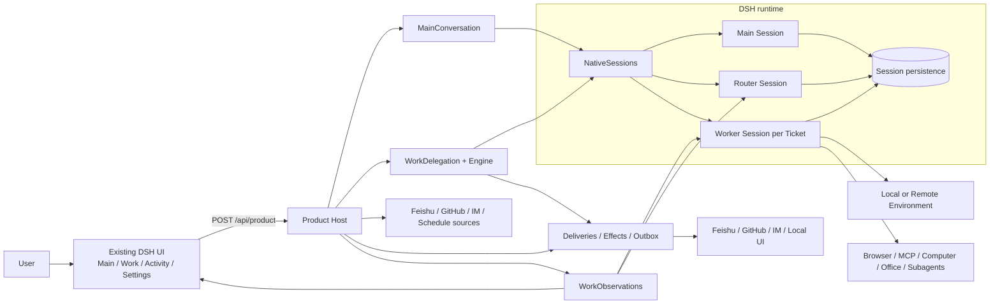
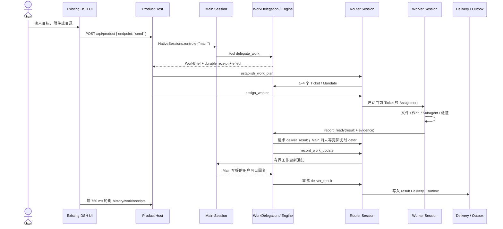
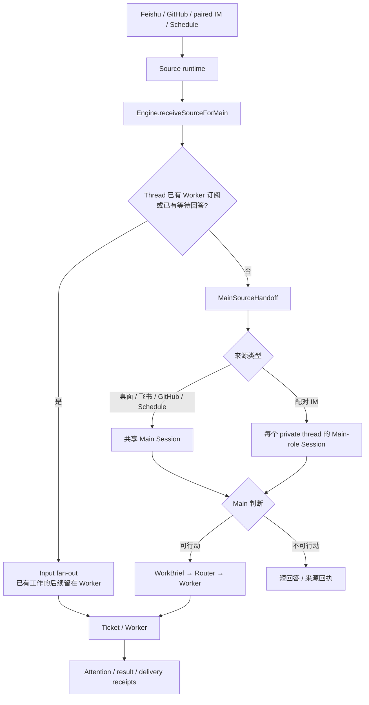
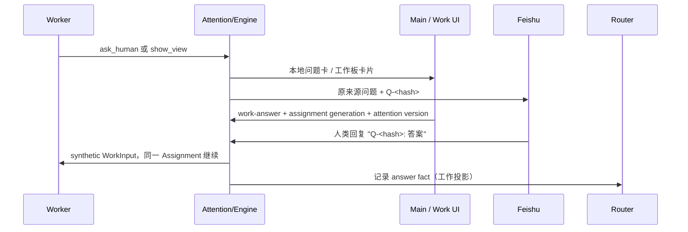

# DSH 集成、产品协议与前端面审计

> 审计快照：2026-11-24，分支 `dev`，提交 `d03bb434`，工作区含未提交改动。
> 范围：`superagent/dsh/`、`superagent/src/product-host.ts`、Main/Router/Worker 交互协议、产品 UI 与外部渠道接线。
> 方法：静态代码通读 + 调用链追踪 + 测试文件盘点。未运行完整测试，未连接真实飞书、GitHub、IM、远端设备或真实模型；因此本文严格区分“代码存在”“有自动测试文件”“已完成真实环境验收”。

---

## 0. 结论先行

1. **当前产品已经不是报告里的“单 Main Session + Worker”原型，而是 Main → Router → Worker 三层。** Main 负责连续对话和用户意图，Router 负责 WorkBrief 分解与 Ticket 路由，Worker 只负责隔离执行。`MainBinding` 同时持有 `mainSessionId` 与 `routerSessionId`，三者是可分别配置模型、指令与推理强度的独立 DSH Session。
2. **文章中最关键的“Router 不直接做执行”在代码里已从提示词约束升级为工具面限制。** 每个 DSH Session 创建时先清空工具，只注册本次请求的 `NativeTool`：Main 没有 Shell，Router 只有控制面工具，Worker 才有文件、命令、作业、Subagent 等执行工具。
3. **最终对外结果不是 Worker 直接发的，而是 Main 组织用户可见回复、Router 负责送达。** `mainResultReply` 只有在 Main 对当前 work update 的回复完成且版本仍有效时才返回文本；Router 的 `deliver_result` 才能把文本写入 Delivery/Outbox。与 Claude 报告所述旧原型“Executor 直接确认、自己开 PR/回评论”相比，当前产品在**产品协议层**恢复了统一出口。
4. **前端是“在现有 DSH 客户端上挂产品视图”，不是另建 renderer。** Main、Work、Activity、Settings 通过 DSH slot 注入；`client.js` 是由 `src/client` 完整打包的生成物，并有专门测试断言其与源文件一致。
5. **文章的四项基础特征中，“连续、持久、可并行”已有很强的代码形状；“全双工输入”和“100 词硬上限”没有完全落地。** Main 忙碌时输入框禁用并显示“Stop reply”，不是文章设想的随时插入新消息；代码中也没有 100 词硬限制，只有飞书 4000 字符传输上限等 `maxTextChars`。
6. **多信道能力显著超出报告原型，但真实性和对称性不均。** 代码包含飞书、GitHub、8 类配对 IM、定时任务、桌面本机与远端客户端；邮箱是手动 IMAP/SMTP 收件箱，不是 Engine 事件 Source。结构化“用原渠道回答 Worker 问题”目前只有飞书有稳定的 `Q-<hash>:` 解析。
7. **当前 UI 新增了报告原型没有的两个关键产品面：** Work 板（工作、停止、跟进、问题、交付状态）和只读 Activity（Router/Worker Session 事实、证据分页、代次、全文详情）。

---

## 1. 入口、装配与生成物

| 层 | 入口 | 作用 | 证据 |
| --- | --- | --- | --- |
| DSH 客户端插件 | `superagent/dsh/src/client/index.js` | 注入 `sessions/workspaces/uiWorkspace/uiConversation/uiSession/slots/theme/layout`，调用 `applyProduct` | `superagent/dsh/src/client/index.js:3-9` |
| 产品 UI | `applyProduct(ctx)` | 注册 Main、Work、Activity、设置、语音、模型引导、Classic 模式 | `superagent/dsh/src/client/product.js:79` |
| 浏览器生成物 | `superagent/dsh/client.js` | 由 `src/client` 打包，1.44 MB，未压缩，带生成头 | `superagent/dsh/client.js:1` |
| 打包脚本 | `build-client.mjs` | esbuild 入口 `src/client/index.js`，CJS，浏览器平台，平台模块外置 | `superagent/dsh/scripts/build-client.mjs:19-58` |
| 生成物测试 | `client-bundle.test.js` | 断言 `client.js` 等于当前源文件构建结果，并断言只导出 `apply/inject` | `superagent/dsh/test/client-bundle.test.js:10-40` |
| Host 插件 | `createProductHost` | 组合 Engine、NativeSessions、渠道、设置、客户端网关与远端环境 | `superagent/src/product-host.ts:208` |
| 产品 HTTP | `POST /api/product` | 前端唯一的产品命令/查询入口；Host 按 endpoint 校验字段并分派 | `superagent/src/product-http.ts:98-130` |
| 产品 RPC 白名单 | `api.js` | 客户端允许 174 个 product endpoint | `superagent/dsh/src/client/api.js:5-38` |

### 1.1 一个 Host，多个来源作用域

`createProductHost` 共用同一个业务存储和 DSH Session 适配器，但为不同来源构造独立 Engine 作用域：

- 本机产品 Engine：`sourceInstanceId = product-desktop`，拥有 Main、Work、设置、远端环境与产品扩展。`superagent/src/product-host.ts:634`
- 飞书 Engine：绑定飞书 source，负责来源事件、向 Main 的交接和飞书 Delivery。`superagent/src/product-host.ts:579`
- GitHub Engine：绑定 GitHub source，负责 Issue/PR/Review/CI 投影与向 Main 的交接。`superagent/src/product-host.ts:604`
- 配对 IM Engine：绑定 `im:paired`，由 `ImMainRelay` 接收受信私聊。`superagent/src/product-host.ts:652-657`

这意味着当前系统的“全局连续性”不是一个通用 Agent 进程，而是**同一 Instance、同一业务存储、同一 DSH Session 持久化边界上的多个来源适配作用域**。是否符合最终设计仍需领域层调查确认，但 UI/协议上确实是这样装配的。

### 1.2 当前端到端结构

---

## 2. 三层运行时：谁看得见什么，谁能做什么

### 2.1 Main：连续对话与用户意图

- Main 的身份同时包含 `mainSessionId` 和 `routerSessionId`，并有逻辑上的 generation。`superagent/src/main-conversation.ts:20`
- Main 的工具面是：
  - `delegate_work`
  - `query_work`
  - `read_work_evidence`
  - `follow_up_work`
  - 本机产品作用域下还有 memory tools；来源请求作用域会收紧。
  证据：`superagent/src/main-conversation.ts:613-744`、`superagent/src/product-host.ts:255-270`。
- `delegate_work` 一次最多建立 1–4 个独立 WorkBrief item；它明确声明“没有 Worker 已启动或完成”。`superagent/src/main-conversation.ts:624`
- 外部来源请求进入 Main 时，Main 只得到来源专用 `delegate_work`，提示词要求保留来源引用；没有正当工作时只给请求者一个简短答案，不得泄露私人 Main 上下文。`superagent/src/main-conversation.ts:749-803`、`superagent/src/main-conversation.ts:909-927`
- Main 达到上下文上限时，`MainConversation` 会记录 rollover，保留逻辑 `mainId`、工作索引、证据引用与未读输入，再切换到新 Session。`superagent/src/main-conversation.ts:160-168`、`superagent/src/main-conversation.ts:1000-1080` 附近。

**与文章的差异：** 文章把“连续、全局序点、多信道对话”都放在 Router；当前产品单独拆出 Main，Router 只处理已接受的 WorkBrief 和 Ticket 控制面。这提升了隐私分区和上下文寿命，代价是多了一层路由/通知链。

### 2.2 Router：控制面，而不是第二个聊天入口

Router 实际工具面是细粒度的：

- `establish_work_plan`：把 WorkBrief 分解成 Ticket。`superagent/src/work-delegation.ts:704`
- `assign_worker`：让 Engine 为 Ticket 绑定并启动 Worker。`superagent/src/execution.ts:770`
- `deliver_result`：在 Main 已生成可交付回复后，把结果写进 Delivery/Outbox。`superagent/src/execution.ts:749`
- `record_work_update`：把 Worker/Engine 的有界事实回传 Main。`superagent/src/work-delegation.ts:1100`
- `acknowledge_attention_answer`：记录人类答案已由 Router 感知。`superagent/src/work-delegation.ts:878`

Router Session 由 `NativeSessions` 串行排队；只有标记 `coalesce` 的通知才合并，最多 7 个工具/请求或约 100 KB。`superagent/src/native-sessions.ts:49`、`:227-271`、`superagent/src/execution.ts:336-368`。

**与文章的差异：** 文章描述 Router 跨所有 Trigger 的批处理；当前 batching 主要发生在 Ticket 的 assign/deliver 通知队列，粒度更窄，但实现上明确有界且可重复。

### 2.3 Worker：隔离执行，不拥有最终交付话语权

Worker 工具远多于 Main/Router：

- 文件与文本：`read_file`、`write_file`、`glob`、`grep`、`read_asset`、`save_attachment`、`stage_attachment`
- 命令与 Office：`run_command`、`run_shell`、`run_office`、`start_command`、`start_shell`、`start_terminal`
- 作业：`job_status`、`read_job_output`、`keep_preview`、`cancel_job`
- Subagent：`delegate_subagent`、`subagent_status`、`cancel_subagent`
- 状态与证据：`report_status`、`read_context`、`read_proactive_source`
- 订阅与交回：`add_thread_subscription`、`remove_thread_subscription`、`handback_input`
- 人工协作：`ask_human`、`show_view`、`report_ready`

证据：`superagent/src/execution.ts:1200-1227`、`:1348-1450`、`:1481-1549`、`:1562-1757`。

Worker 的 `report_ready` 必须给出非空 result/evidence，并在绑定 Environment 中满足“最后一次写入之后有成功验证”的规则。`superagent/src/execution.ts:1757-1815`。

**注意边界：**

- 产品协议里没有给 Worker 一个“直接给用户发消息”的工具；最终可交付文本由 Main 生成。
- 但 Worker 仍有 `run_shell`、MCP、浏览器、Office 和远端命令能力，完全可以产生外部副作用。**产品层出口统一不等于进程层安全沙箱。**

### 2.4 DSH 工具限制是强制性的

`NativeSessions.execute` 在创建/恢复 Agent 时：

1. `scoped.tools.restrict({ allow: [] })`
2. 只注册本次 `request.tools`
3. 用 role-specific system prompt 标明 Main/Router/Worker 职责

证据：`superagent/src/native-sessions.ts:306-324`。

这比 Claude 报告描述的旧原型更可靠：旧原型 Router 仍有 bash/read，只是提示词要求“不读代码”；当前 Main 根本没有 shell 工具。

---

## 3. 三条关键交互链

### 3.1 本地 Main：一次工作如何从对话变成结果

关键代码：

- Main 输入串行队列与回复提取：`superagent/src/main-conversation.ts:1073-1133`。
- Work update 重新进入 Main：`superagent/src/main-conversation.ts:1158-1235`。
- Router 的 `report-ready` 入口与 `MAIN_RESULT_PENDING` 延迟：`superagent/src/execution.ts:336-368`、`:734-778`。
- WorkDelegation 在基础 effect 之后刷新 Ticket 并通知 Main：`superagent/src/work-delegation.ts:765-848`、`:1068-1101`。
- `mainResultReply` 只有在 Main 回复完成、版本匹配、work update 完成时才返回：`superagent/src/work-delegation.ts:115-140`。

**架构含义：** 结果交付是“两段式”的：Worker 只提交 verified report；Main 写用户语言；Router 负责投递。它比旧原型更符合文章“Router/Worker 分工”，也减少了 Worker 对多信道语气的直接暴露。

### 3.2 外部来源：新请求进 Main，已拥有事件直通 Worker

证据：

- 新人类请求进入 Main：`superagent/src/engine.ts:543-565`。
- 已有订阅、已有 ownership、已有等待中的飞书回答先走 fan-out，不新建 Main handoff：`superagent/src/engine.ts:551-558`。
- 飞书、GitHub、定时器共用当前 Main Session；配对 IM 使用 `im-<thread-hash>` 的独立 Main-role Session：`superagent/src/main-conversation.ts:817-820`、`:839-849`、`:951-958`。
- 只在非 delegated 且来源为 IM/飞书时，把 Main 短回答写回原来源：`superagent/src/main-conversation.ts:951-961`。

**重要限制：** 当前代码里 GitHub 直接回答没有对应的 `main-source-reply` outbox 分支；GitHub 的直接问答很可能只显示在本地 Main，除非另有未发现的适配路径。需要真实 GitHub 验收确认，不能从 UI 有卡片就推断已回写评论。

### 3.3 Worker 问题：结构化回答直接回同一条工作

证据：

- `Attentions.ask` 把 Ticket 置为 `waiting-human`，生成 Delivery。`superagent/src/attention.ts:55-100`
- 回答时创建 synthetic input，恢复原 Ticket。`superagent/src/attention.ts:107-140`
- Host 的 `work-answer` 走 `answerMainAttention`，版本/代次校验后再回答。`superagent/src/product-host.ts:1642-1650`
- 飞书问题带稳定 `Q-<16 hex>:` 提示；Engine 只接受同 thread、同 actor、当前版本的问题代码。`superagent/src/feishu-delivery.ts:30,73-75`、`superagent/src/engine.ts:634-680`
- 回答后 Router 只记录 fact，不用第二遍模型改写用户答案。`superagent/src/work-delegation.ts:1413-1465`

**与文章差异：** 文章说 Worker 通过 Router 统一向用户提问。当前产品让受信 Engine 直接把结构化问题送到原来源或 Work UI，并让答案直接恢复同一 Worker Assignment；Router 只维护工作投影。这更短、更像“直接交受信核心”，但要求 Attention/版本/owner 的授权边界非常严。

---

## 4. 当前产品前端信息架构

### 4.1 四个可见表面

| 表面 | 入口/组件 | 用户能做什么 | 证据 |
| --- | --- | --- | --- |
| Main | `MainConversation`、`NativeComposer`、`conversation.chat.turnTail` | 连续对话、附件、目录/执行环境、语音、停止回复、问题卡、工作/来源/准备卡片 | `superagent/dsh/src/client/product.js:1022-1365`、`:1990-2065` |
| Work | `BoardSurface` / `WorkBoard` | 查看 Running / Waiting delivery / Waiting human / Delivered / Stopped，停止工作、加跟进、回答问题 | `superagent/dsh/src/client/work-board.js:72-130`、`superagent/dsh/src/client/product.js:192-231` |
| Activity | `ObservationConversation` | 只读查看 Router/Worker Session、代次、状态、证据、工具事实、分页详情；可复制，不注入 Main 上下文 | `superagent/dsh/src/client/product.js:1370-1540`、`superagent/src/work-observations.ts:1-120` |
| Settings | `SettingsDialog` + `SettingsShell` | 10 组、27 个设置分区；搜索、锚点、键盘焦点、离开未保存确认 | `superagent/dsh/src/client/settings-navigation.js:3-58`、`superagent/dsh/src/client/product.js:1588-1935` |

额外表面：

- **Classic Agent mode**：本机 Host 所有者可切到独立授权的 DSH 原生 Session，再返回同一 Main；不是新渲染器。入口/返回见 `superagent/dsh/src/client/product.js:2180-2288`。
- **Connect to Host**：桌面客户端可连接已授权的远端 Host；连接态下设置和本地管理员操作隐藏/拒绝。`superagent/dsh/src/client/product.js:1937-1988`、`:2280-2290`。

### 4.2 设置分区

当前 `SETTINGS_GROUPS` 是 10 组，展开后 27 个 section：

- Overview
- General
- Look and feel
- Models：Providers / Agent presets / Built-in plugins
- Team：Roles / Memory
- Work：Execution policy / Calendar / Scheduled tasks / Proactive preparation / Supervision
- Connect：Connectors / IM / Phone
- Tools：Browser resources / Browser plugin / Computer control / Capability library / Secrets / Credential resources / Remote clients
- Usage：Usage / Status
- About DS SuperAgent：Feedback / About

计数由 `settings-navigation.js` 实际导出计算：10 groups、27 sections。

**可用性不是一律开放：**

- 设置入口只在本地、非远端连接时开放：`settingsAvailable: Boolean(binding && !connection.connected)`。`superagent/dsh/src/client/product.js:2284-2290`
- Host 对远端 client 拒绝 schedule、provider、execution policy、remote environment、GitHub 管理、supervision、proactive、preset、resource/credential/MCP、browser、memory、status 等管理端点。`superagent/src/product-host.ts:758-940`
- Browser、Computer、MCP、Office、远端 Environment 和 IM 均要求对应 Host adapter/config；页面存在不代表默认启用。
- Remote clients 支持 read 或 read+command 两种授权；credential 只展示一次。`superagent/dsh/src/client/product.js:1524-1586`

### 4.3 实时性

- 产品 RPC 是 unary `POST /api/product`；没有为产品状态新增专用 SSE。
- 前端以 750 ms 轮询刷新 Main、Work、Activity、设置概览和远端状态。`superagent/dsh/src/client/product.js:525-530`
- Main 的对话流另走 DSH 原生 Session `eventSource`；`NativeComposer`/`NativeTurnCards` 订阅它来显示流式回合。`superagent/dsh/src/client/product.js:2005-2038`
- Work Board 额外按约 2 s 节奏刷新；Activity 随主轮询刷新。`superagent/dsh/src/client/product.js:154-180`、`:525-520`

**评价：** 代码上这是一个“unary 产品控制面 + 原生 Session 流 + 周期轮询”的混合模型，不是纯 SSE/WebSocket 产品数据总线。对远端浏览器/手机的电量与延迟影响尚未实测。

### 4.4 可访问性与交互细节

- 设置弹层有焦点陷阱、Esc、返回焦点、未保存角色草稿确认。`superagent/dsh/src/client/settings-shell.js:47-120`
- 问题卡有 `aria-labelledby`、选项 `aria-pressed`、自由文本、Enter 提交。`superagent/dsh/src/client/main-question.js:6-50`
- Work 停止有二次确认、5 秒确认窗口、错误提示。`superagent/dsh/src/client/work-board.js:10-45`
- 减少动作模式、`prefers-reduced-motion`、移动端 640px 断点均有处理。`superagent/dsh/src/client/styles.js`、`product.js` 的 CSS 段。

---

## 5. 产品协议与关键不变量

### 5.1 路由和身份

- 本地 UI 只接受当前 Instance 的 Main；`requireMain` 在 upstream 适配层阻止切换到别的 main/session。`superagent/dsh/src/client/product-api-upstream.js:40-49`
- 远端 client 请求由 Host 接管身份并检查 capability；不能通过 payload 冒充 Instance。`superagent/src/product-host.ts:733-755`
- Work 控制必须同时带 `workItemId`、`ticketId` 与 `expectedGeneration`；问题的回答还要 `attentionId`、`attentionVersion`。`superagent/src/work-delegation.ts:353-380`、`superagent/src/product-host.ts:803-806`

### 5.2 Work/界面的稳定对象

- 稳定单位是 WorkItem/Ticket，而不是 DSH Session。
- UI 的 follow-up 明确绑定一个 `workItemId`，并有 `ticketId` 与方向版本。
- Work Card 同时暴露 `receipt`、`outcome`、`control`、`followUps`、`executionLocation`。
- Activity 还可查看 Assignment generations，历史代次仍可读。

证据：`superagent/src/work-delegation.ts:155-370`、`:1598-1635`；`superagent/dsh/src/client/product.js:679-900`、`:1370-1490`。

### 5.3 交付账本

- `deliver_result` 只有在当前 ready report、当前 assignment、当前 direction version、Ticket open 且 Main 回复已落盘时才返回文本。`superagent/src/execution.ts:749-767`、`superagent/src/work-delegation.ts:115-140`
- Unknown Delivery 有显式 reconciliation 入口，不把失败直接重发。`superagent/dsh/src/client/product.js:953-1020`
- Feishu 使用 1 小时 uuid 去重；55 分钟后 unknown 不再盲目重发。`superagent/src/feishu-delivery.ts:75-105`

### 5.4 上下文隔离

- Main 工具和 Router 工具都不包含文件/Shell。
- Work update 只把有界 JSON 事实交给 Main，不把 Worker transcript 注入 Main。`superagent/src/work-delegation.ts:1097-1100`
- Activity 通过单独读取 Session log 展示过程，且客户端/服务端都对 Bearer、api_key、token、secret、password 做正则脱敏。`superagent/src/work-observations.ts:110-118`、`superagent/dsh/src/client/product.js:2350-2354`
- 这实现了“工作可观察但不污染主对话”的方向，但正则脱敏不是完整的 secret manager，不能视为安全保证。

---

## 6. 多信道和来源能力矩阵

| 通道 | 进入路径 | Main 直答 | 已有工作 fan-out | 问题回原渠道 | 结果回原渠道 | 代码状态/限制 |
| --- | --- | --- | --- | --- | --- | --- |
| 本地 UI | `/api/product send` | 是，Main 对话 | 是，Work/问题卡 | 是，Work 卡或 Main 输入 | 是，Main reply + Work card | 当前主路径；无真实外部依赖 |
| 飞书 | `FeishuSource` / `FeishuRuntime` | 是，共享 Main Session | 是 | 是，`Q-<hash>:` 答案解析 | 是，Feishu Delivery | 代码和自动测试较完整；真实租户未验收 |
| GitHub | `GitHubSource` / `GitHubRuntime` | 是，共享 Main Session | 是 | 仅找到“Delivery 到 GitHub + UI 回答”路径；源码自动解析 GitHub 回答未发现 | 是，Router/`deliver_result` → GitHub Delivery | 仍需真实仓库验收；直接 Main 回答未发现 outbox 分支 |
| 配对 IM | `ImMainRelay` + 8 个 adapter | 是，每个 private thread 独立 Main-role Session | 是 | Delivery 可到 IM；原渠道结构化回答解析未发现 | 是，`ImMainRelay.deliver` | 8 平台：Feishu/DingTalk/WeCom/QQ/WeChat/Discord/Slack/Telegram；真实账号未验收 |
| 定时任务 | `ScheduleSource` | 是，Main handoff | 是 | 未发现类似飞书的回源回答语法 | 取决于 Ticket 原始 destination；通常本机/来源 | 是 `ScheduleSource`，但“定时任务向人提问”的完整闭环需验收 |
| 邮箱 | 手动 IMAP/SMTP mailbox | 否（不是 Engine Source） | 否 | 否 | 手动回复 | 只有设置页收件箱、规则和回复；没有 MailSource → Trigger 接线 |

证据：

- 8 个 IM 平台：`superagent/src/im-accounts/types.ts:1`
- GitHub/GitHubDelivery：`superagent/src/channels.ts:60-210`、`superagent/src/github-delivery.ts`
- 飞书：`superagent/src/channels.ts:199-344`、`superagent/src/feishu-delivery.ts:30-110`
- Schedule：`superagent/src/channels.ts:345-430`
- 配对 IM：`superagent/src/im-main-relay.ts:15-62`
- 邮箱：`superagent/src/product-connectors/index.ts:443-617`

### 6.1 文章“100 词”约束

**未发现** `100 words`、`wordCount`、`maxWords` 或等价硬限制。

- 当前可见限制是飞书 `maxTextChars`（默认 4000）和通用 Delivery 文本上限。
- 文章要求的“IM 单次回复不超过 100 词”在代码层没有对应实现；只剩 prompt 中的“brief/concise”语气要求。

因此该条应从“旧原型的提示词已实现”降级为**当前代码未落地**，除非另有未被本审计发现的提示词生成器。

### 6.2 全双工

- Worker 有明确的后台作业和 Subagent 唤醒路径，不等同步 Shell。
- Main UI 不是全双工：`MainComposer` 在 `busy` 时禁止 submit，只显示 `Stop reply`。`superagent/dsh/src/client/composer.js:97-137`、`superagent/dsh/src/client/product.js:1262`
- Main 的 durable input 队列是串行的；`MainConversation` 维护 tail、active command、stop 事实。
- 因此应判定为“**执行层异步化，主对话 UI 仍然半双工**”，而不是文章 §4.1 那种用户可在模型回复期间继续插入。

---

## 7. 与 Claude 报告的逐项对照

状态定义：

- **已实现（代码）**：有清晰代码路径，且有至少一个相关测试文件或直接不变量。
- **部分/换做法**：主路径存在，但与文章粒度或语义不同，或只在限定条件开启。
- **未发现**：本次范围没有找到实现；不排除未来/其他模块。
- **无法确认**：代码存在，但真实服务/平台验收不在本次审计证据。

| 文章概念 | Claude 报告中的旧原型 | 当前 DS-SuperAgent | 判定 | 主要依据 |
| --- | --- | --- | --- | --- |
| 双层 Router + Worker | main Session + Executor Session | **Main + Router + Worker 三层**；Main 对用户，Router 管 WorkBrief/Ticket，Worker 执行 | **超越/不同** | `main-conversation.ts:20`; `work-delegation.ts:672`; `execution.ts:828` |
| Router 不直接做任务、可不配 Bash | 靠提示词约束，仍有 bash/read | Main/Router 都不注册文件/Shell；Worker 才有 | **已实现（强约束）** | `native-sessions.ts:306-324`; `main-conversation.ts:613`; `execution.ts:1200-1227` |
| Router 轻量模型 | 可配置 | Main/Router/Worker 三套独立 model/effort/instructions | **已实现** | `product.js:1611-1615`; `config.ts:7-112` |
| Worker 隔离上下文、一 Ticket 一 Session | 是 | 每 Ticket Assignment + DSH Session；WorkObservation 保留代次 | **已实现** | `execution.ts:1193-1270`; `work-observations.ts:60-120` |
| Worker 内可建 Subagent | 是 | `delegate_subagent` 继承 Worker 目录、权限与工作工具 | **已实现** | `execution.ts:1474-1549` |
| Router 统一对外，Worker 不直接说话 | 旧原型 Worker 直接 ack/PR/review | 产品层没有 Worker 发送工具；最终文本由 Main 生成，Router deliver_result 投递 | **不同且更强** | `execution.ts:749`; `work-delegation.ts:115-140` |
| 两级过滤 / Fast-Slow | Source gate + Eval | 新人类来源直接进 Main；已有 ownership 直接 fan-out；Engine 仍有 Eval 路径 | **换做法/部分** | `engine.ts:543-565`; `channels.ts:60-210` |
| Thread / 订阅直通 / 多对多 | Ticket 订阅 Thread | WorkItem/Ticket 为稳定单位，主 UI 明确以 workItem+ticket+generation 控制；订阅在 Engine 层 | **部分确认** | `work-delegation.ts:214-252,353-370`; `execution.ts:1660-1700` |
| Batch / Router 聚合 | Thread 级 Eval 串行合并；route 1–20 | Router queue 串行；最多 7 个 coalesce notification/约 100 KB | **部分/换粒度** | `native-sessions.ts:49,227-271`; `execution.ts:336-368` |
| Inline & Spill | 卡片内联 + 截断读取 | Main/Work 卡片 + evidence 分页 + Activity detail 分页；Full cache/locality 不在本层 | **部分（产品面）** | `product.js:905-1035,1370-1490`; `work-observations.ts` |
| 链式召回 | trigger/thread/ticket 引用图 | WorkItem/Ticket/Trigger/Attention/Report/Delivery 都有稳定 ID；Main 可读 evidence、Activity 可下钻 | **已实现（对象图）** | `work-delegation.ts:119-140,1281-1305`; `product.js:368-386` |
| 投机执行 | Policy + observe/auto | Proactive preparation / rules / review UI | **部分/功能面存在** | `product-proactive.js`; `MainPreparationCard` |
| 异步 ReAct / 全双工 | 5 秒转后台 + 唤醒 | Worker 有 start_shell/start_terminal/Subagent 与完成事件；Main UI 在 busy 时禁止输入 | **部分（Worker 强，Main 半双工）** | `execution.ts:1348-1450`; `composer.js:97-137` |
| IM ≤100 词 | 提示词硬上限 | 没有 word/wordCount 限制；只有字符上限 | **未发现** | `feishu-delivery.ts:36-80`; 全仓无 `maxWords` |
| 多信道 | 飞书 + GitHub | UI + 飞书 + GitHub + 8 IM + Schedule；邮箱手动 | **显著扩展/部分验收** | `channels.ts`; `im-accounts/types.ts:1`; `product-connectors` |
| 问题卡片 / 结构化问答 | 旧原型有 question / Attention | `ask_human`/`show_view` → Attention → Work/Main 卡片；飞书 Q code | **已实现（本地/飞书）；其他渠道不均** | `attention.ts:55-140`; `product.js:679-870`; `feishu-delivery.ts:73` |
| Watchdog / 自愈 | 只查退出码 | 当前层有 Supervision UI/Engine 接缝；是否模型驱动由其他模块决定 | **无法确认（本层外）** | `settings-navigation.js`; `product-supervision.js` |
| 存算分离 / BYOM | 单机 SQLite | PostgreSQL、Session persistence、远端 Environment / client gateway | **部分/重大推进** | `postgres-storage.ts`; `profile.ts`; `product.js` execution target |
| 面板只给监督者 | 旧原型是独立面板 | 当前把 Main/Work/Activity 嵌入 DSH UI；Activity 只读 | **产品形态改变/增强** | `client/index.js`; `product.js:1990-2060` |

---

## 8. 当前完成度：按“代码面 / 测试面 / 验收面”拆分

> 这里不把测试文件存在当成测试通过；也不把 UI 页面存在当成真实服务验收。

| 能力 | 代码面 | 自动测试文件 | 真实验收 |
| --- | --- | --- | --- |
| Main 连续对话、附件、语音、停止回复 | 完整 | `composer.test.js`、`product-main-voice.test.js`、`product-api.test.js` | 仅本地/夹具；真实模型与平台另验 |
| Main → Router → Worker 控制链 | 完整 | `native-runtime.test.mjs`、`product-execution.test.mjs`、`work-delegation` 相关测试 | 需真实模型、长工作链 |
| Work Board / 停止 / 跟进 / 问题回答 | 完整 | `product-api.test.js`、`product-work-view.test.js`、`product-turn-cards.test.js` | 本机桌面已有部分实现记录，未在本审计复验 |
| Activity 只读观察 | 完整 | `work-observations.test.mjs`、`product-observation-state.test.js` | 有 Session 日志/夹具；真实长日志未验 |
| Settings 10 组 27 分区 | 完整 | `product-settings-navigation.test.js`、`settings-shell.test.js`、各 settings 测试 | UI 夹具；依赖 Host adapter 的页面另验 |
| 飞书来源/问题/结果 | 较完整 | `feishu-answer.test.mjs`、`feishu-delivery.test.mjs`、`main-feishu-intake.test.mjs` | **真实飞书租户未验** |
| GitHub 来源/结果 | 较完整 | `product-github-delivery.test.mjs`、`main-github-intake.test.mjs` | **真实 GitHub 仓库/评论未验**；直接回答回写有缺口 |
| 8 类配对 IM | adapter 代码存在 | `im-accounts.test.mjs`、`im-main-host.test.mjs`、`im-settings.test.js` | **真实账号全部未验** |
| 邮箱 | 手动 IMAP/SMTP/规则/回复 | `product-connectors-host.test.mjs` | 真实邮箱未验；不是 Source |
| 100 词 IM 约束 | 未发现 | 未发现 | 需要产品决策：改 prompt 还是改传输/生成器 |
| Main 全双工输入 | 未实现为可插入新消息 | `composer.test.js` 只覆盖草稿/语音 | UI 当前半双工 |
| 远端 Host / 设备 | 代码面存在 | `product-client-gateway.test.mjs`、`remote-*` | 真实设备/网络未验 |
| 外部渠道的“自动结构化回答” | Feishu 有；GitHub/IM 未发现 | Feishu answer tests | 需要真实渠道/设计确认 |

### 8.1 可用指标

- 自有客户端源码：**74 个文件、约 15,521 行**（排除 `upstream/`、`locales/` 与生成物）。
- 客户端源码总计：**211 个文件**，其中 `upstream/` 131 个文件、约 39,750 行。
- 产品 RPC 白名单：**174 个 endpoint**。
- 设置：**10 组、27 个 section**。
- DSH 测试文件：**48 个**，其中 `product-*.test.js` 26 个。
- 服务端测试文件（全局，不只本层）：**149 个**。
- 当前生成客户端：`client.js` **1,440,034 bytes**。

这些数字描述代码规模，不代表完成质量或验收通过。

---

## 9. 真实缺口与风险

### 9.1 明确缺口

1. **没有文章要求的 100 词 IM 硬约束。** 当前飞书传输最多 4000 字符，没有 word count。
2. **Main 输入不是全双工。** 忙碌时 composer 禁止发送；用户只能 Stop reply，不能无缝插入下一句。Work 仍在跑，故“工作并行”与“对话同时输入”要分开表述。
3. **结构化原渠道回答只有飞书。** 飞书有 `Q-<hash>`；GitHub/IM 的自动解析未发现。GitHub 评论不会在本层自动完成 Attention 回答，仍需 UI 回答或其他未发现路径。
4. **GitHub 直接 Main 回答的回写路径缺失。** `main-source-reply` outbox 只在 IM/飞书分支创建；GitHub 无对应分支。
5. **邮箱不是 Engine Source。** 设置页可以手动看信/回复，但不会自动形成 Trigger/Thread/Work。
6. **渠道真实验收不完整。** 代码与测试文件存在，但不能推断真实飞书/GitHub/IM 账号、权限、配额、限流、重连均已通过。

### 9.2 设计性风险

1. **统一出口增加延迟。** `report_ready` 后要等 Main 生成用户可见回复，Router 才能 `deliver_result`；Main busy 时 Delivery 会 defer。好处是语气/权限统一，代价是延迟与 Main 可用性别耦。
2. **Main/Router 分离导致两套上下文。** Main 有工作索引和证据，Router 有 WorkBrief/计划；两边必须靠稳定 ID 和 bounded projection 对齐，异常恢复依赖这些事实。
3. **IM 与共享 Main 的上下文边界不同。** 飞书/GitHub/Schedule 在共享 Main Session；配对 IM 使用独立 `im-<hash>` Main-role Session。产品数据上仍显示为同一 Main 的 source card，但模型上下文不同，做“跨信道连续记忆”验收时需特别区分。
4. **轮询成本。** 产品状态每 750 ms 查询一次；Work 额外 2 s 刷新。对桌面可接受，对远端/移动端可能不是最优。
5. **Activity 脱敏是启发式。** 只有 Bearer/key/token/secret/password 正则；不能替代安全存储或完整日志审计。
6. **产品 RPC 白名单与 Host 分派是两套手写集合。** 174 个 endpoint 的 client allowlist、Host field validation、switch dispatch 需要持续测试防漂移；当前已有测试但这属于长期维护风险。
7. **当前工作区未提交改动较多。** 本报告反映的是 2026-11-24 工作树，不是已发布提交；最终 HTML 需要明确快照。

### 9.3 证据不足

- 真实模型对 Main/Router/Worker 三种 profile 的实际行为差异。
- 大上下文 rollover 在真实长会话中的连续性。
- 多个外部来源同时到达时的端到端延迟与公平性。
- 远端设备离线/重连、桌面睡眠、网络切换下的 Delivery/Attention 一致性。
- 所有 8 个 IM adapter 的真实平台协议稳定性。
- 邮箱规则是否应升级为正式 Source，目前只有产品意图和 UI，没有 Engine 接线。

---

## 10. 给最终 HTML 的视觉叙事建议

1. **首屏：“不是两个角色，而是三层节奏”。** 左侧一条连续 Main 轨道，中间 Router 控制面，右侧多条隔离 Worker 轨道；用不同颜色显示“对话 / 路由 / 执行”，底部用 receipt 徽章表示“已接收、等待交付、待回答、已交付”。
2. **主叙事图：“谁写结果，谁送达”。** 用一个横向 swimlane：
   `Worker → verified report → Main 用户语言 → Router deliver_result → Channel receipt`。
   这能直观解释当前相对 Claude 报告旧原型的关键进化。
3. **问题回路的逆向箭头。** 问题不是简单“Main 转发”：`Worker ask_human → Attention → 原来源/Work UI → 直接恢复同一 Worker`；Router 只记录投影。用虚线区分“回答”与“通知”。
4. **来源分流图。** 外部请求先判断 Thread 是否已有 Worker 订阅：有则 fan-out，无则 Main handoff；再用来源色标出 Feishu/GitHub/IM/Schedule，并标注“只有飞书有 Q-code 自动回答”。
5. **可观测性三层钻取。** Main 卡片 → Activity 摘要 → 证据全文；配合“只读、分页、脱敏”标签，说明它不会变成第二个聊天入口。
6. **成熟度四象限。** 横轴“代码表面”，纵轴“真实验收”；把“Main/Work/Settings”放在高代码面，把“真实 IM/邮箱/GitHub 直接问答”放在待验证区，避免把 174 个 endpoint 直接等同于完成度。

### 10.1 可直接复用的图表数据

- 3 个角色、3 个独立 model/instructions 配置。
- 10 个设置分组、27 个设置 section。
- 174 个客户端允许的 product endpoint。
- 8 个 IM 平台。
- 48 个 DSH 测试文件，26 个 product-specific。
- 74 个自有客户端源文件、约 15,521 行。
- 3 个主要产品视图：Main、Work、Activity；外加 Settings 和 Classic。

---

## 11. 关键证据索引

| 断言 | 代码/测试 |
| --- | --- |
| DSH 客户端集成与注入 | `superagent/dsh/src/client/index.js:3-9` |
| 产品 UI 注册与 Workspace slot | `superagent/dsh/src/client/product.js:79-110, 2280-2340` |
| 产品 RPC 协议 | `superagent/src/product-http.ts:98-130` |
| 174 个 endpoint allowlist | `superagent/dsh/src/client/api.js:5-38` |
| 生成客户端与源文件一致性测试 | `superagent/dsh/test/client-bundle.test.js:10-40` |
| Main 工具面 | `superagent/src/main-conversation.ts:613-744` |
| Router 控制面工具 | `superagent/src/work-delegation.ts:704,878,1100`; `superagent/src/execution.ts:749,770` |
| 工具面强制隔离 | `superagent/src/native-sessions.ts:306-324` |
| Worker 执行工具 | `superagent/src/execution.ts:1200-1757` |
| Main 组织结果、Router 投递 | `superagent/src/work-delegation.ts:115-140`; `superagent/src/execution.ts:734-767` |
| 问题与直接回答 | `superagent/src/attention.ts:55-140`; `superagent/src/engine.ts:3584-3622` |
| 飞书问题代码 | `superagent/src/feishu-delivery.ts:30,73-75`; `superagent/src/engine.ts:634-680` |
| 来源进入 Main / 既有工作 fan-out | `superagent/src/engine.ts:543-565` |
| 配对 IM 的独立 Main-role Session | `superagent/src/main-conversation.ts:817-849`; `superagent/src/im-main-relay.ts:15-62` |
| 8 个 IM 平台 | `superagent/src/im-accounts/types.ts:1`; `superagent/src/im-accounts/adapters.ts:6-13` |
| Work 板 UI | `superagent/dsh/src/client/work-board.js:72-130` |
| Activity UI 与只读 | `superagent/dsh/src/client/product.js:1370-1540` |
| 脱敏实现 | `superagent/src/work-observations.ts:110-118`; `superagent/dsh/src/client/product.js:2350-2354` |
| 设置 10 组 27 分区 | `superagent/dsh/src/client/settings-navigation.js:3-58` |
| 设置本地专属 | `superagent/dsh/src/client/product.js:2280-2290`; `superagent/src/product-host.ts:758-940` |
| 750 ms 轮询 | `superagent/dsh/src/client/product.js:525-530` |
| Main 半双工 composer | `superagent/dsh/src/client/composer.js:97-137` |
| 邮箱手动能力 | `superagent/src/product-connectors/index.ts:443-617` |
| 多来源 Engine 装配 | `superagent/src/product-host.ts:579,604,634,652-657,733` |

---

## 12. 最终判断

从 **DSH 集成、产品协议和 UI** 这一层看，当前 DS-SuperAgent 不是 Claude 报告里那个“原型面板 + 单机 Main/Executor”的简单延伸，而是已经形成了：

> **一个 DSH 原生产品外壳 + 三层角色会话 + 持久工作账本 + 多渠道出口 + 只读执行观察 + 本地/远端执行控制面。**

文章的四项特征里，“连续、持久、工作并行”已经有可检验的代码结构；“主动”与“自愈”需要与领域/运维层合并判断；“全双工”和“100 词硬约束”仍是明确缺口。多信道不是简单的“有无”，而是“飞书最完整、GitHub 有重要回写缺口、IM 面广但结构化回答不足、邮箱不是事件源”。这些差异应在最终报告中用“代码存在 / 自动化证据 / 真实环境证据”三档展示，避免把 UI 表面误当成完成度。
