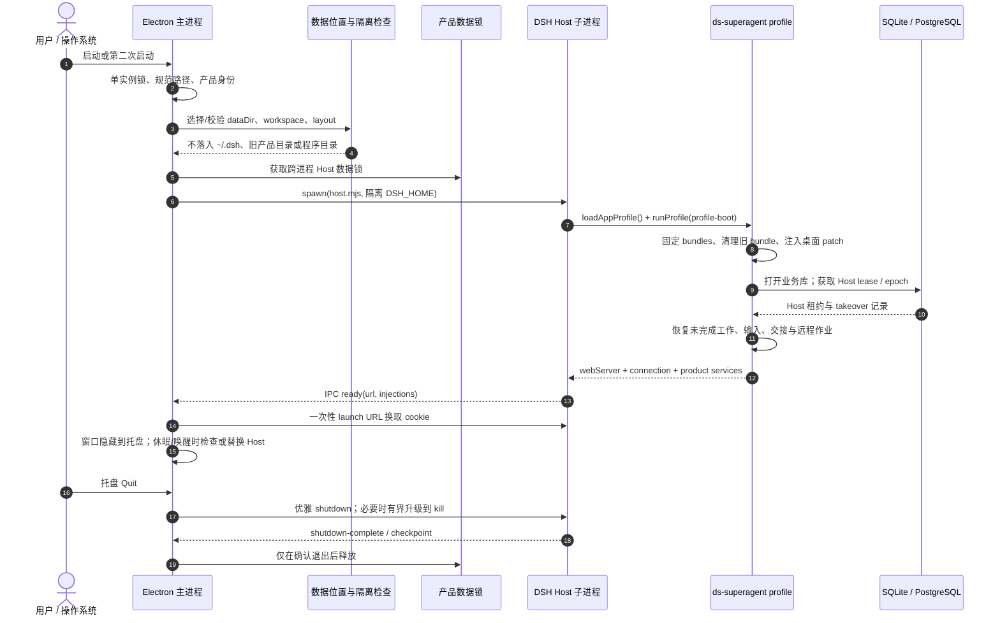

# 03 · 桌面、部署、隔离与恢复审计

审计快照：`dev` / `d03bb4349a27752a032284c78790f53737bb5ab8`，2026-11-24 14:38 +08:00。工作区已有未提交改动（含 `superagent/src/product-host.ts`、`superagent/src/product-providers.ts`、`app/scripts/`、`app/src/startup-window.css`），本文按当前工作区读取，不把这些改动当作已提交发布物。

范围：`app/`、桌面启动链、产品 profile 装配、数据隔离、执行环境、远程设备、Host 接管、自愈、凭据边界、测试与 CI 配置。参考基准为 `super-agent-references/claude-analysis/superagent-report.md` 第 4.2 节、§5 与 §6。

## 结论先行

1. 当前 DS-SuperAgent 不是 Claude 报告所描述的“单机研究原型”形态，而是已有可安装桌面壳、独立产品 profile、持久业务库、Host 租约与接管、后台自愈、远程设备协议和 PostgreSQL 选项的产品工程。
2. 桌面启动链遵守“只通过 DSH 公开入口启动”的约束：固定 DSH `0.2.2-rc.1`，使用 `profile-boot/runProfile()`，不修改 DSH，也不读取用户自己的 `~/.dsh` 作为运行数据。
3. “计算与状态分离”取得实质进展：业务库与原生 Session 均可切到 PostgreSQL；但仍是一个 Host 控制面、一个逻辑 Instance、单 Router，没有无状态计算池或水平扩展证据。
4. “端侧 daemon / BYOM”已从零推进为可运行实现：配对、加密 RPC、文件/搜索/命令、稳定作业 ID、断线观测、设备重启恢复、工作副本交接和选择证据都在代码与测试中。但设备入口仍是 `dev/remote-device.mjs`，没有安装型系统服务/桌面内托管；生产网络硬化仍是缺口。
5. 监督分成两层：Host 内的语义 Supervisor 会自动巡检并给出“纠偏/暂停”提案，执行前需人批准；独立 Watchdog 负责进程故障与优雅重启，但桌面壳默认不配置它。桌面壳已经拥有 Host 子进程时，外部 Watchdog 只能观察，不能接管进程。
6. 交付证据很强但验收不完整：代码与 CI 覆盖庞大，Windows 打包/UIA/启动/更新有候选验收记录；当前快照没有运行全量门禁，真实模型、真实账号、第二设备、托管 PostgreSQL、英文界面、Narrator 与跨平台同 SHA 验收仍不能由本次静态审计替代。

## 代码级启动与生命周期

关键证据：

- 固定 DSH 版本与版本一致性：`app/package.json:31`、`superagent/package.json:3`、`superagent/package.json:174`。
- 桌面只加载一个产品栈：`@deepseek-ai/dsh-base`、`dsh-web-app`、语音输入 bundle、`ds-superagent`（`app/src/profile.mjs:8-9`）。
- Host 通过 `runProfile()` 与 `loadAppProfile()` 启动，未绕过 DSH 入口（`app/src/host.mjs:18-37`）。
- 桌面 Host 的 `DSH_HOME` 被强制设为产品数据目录下的 `superagent/`，同时把用户 DSH 路径仅作为禁止写入的受保护路径传入（`app/src/main.mjs:603-629`；`app/src/profile.mjs:50-53`）。
- 桌面设置目录本身也做绝对路径与隔离校验（`app/src/product.mjs:26-40`），并检查用户 `~/.dsh`、旧产品目录与程序目录（`app/src/dsh-home.mjs:4-12`、`app/src/copy-tree.mjs:19-30`）。
- Host 是独立子进程，有一代进程级生命周期和 IPC（`app/src/host-process.mjs:56-128`）；其退出码、stderr 尾部和关闭检查点都进入恢复判断。
- 产品数据锁先于 Host 启动，并在确认退出后释放；未知退出会保持锁定而不是让第二个 Router 进入（`app/src/main.mjs:294-328`、`app/src/main.mjs:550-563`）。
- 启动失败可重试或回滚；数据目录移动先停 Host、暂存复制、整体改名（`app/src/main.mjs:855-905`、`app/src/main.mjs:1421-1449`；`app/README.md:53-65`）。

## Host 租约、接管与恢复

Host 不是只靠进程存活判断。业务库保存 `host-lease`、`host-takeover` 与 epoch：

- 同一未过期租约禁止第二个 Host 接入；显式 takeover 才推进 epoch（`superagent/src/host.ts:72-110`）。
- 接管时在一个事务内写入 pending takeover，使新工作不能在恢复完成前被接纳（`superagent/src/host.ts:77-106`）。
- 旧进程若仍持有租约，新进程得到 `HOST_LEASED`；过期租约才进入接管（`superagent/src/host.ts:88-100`、`superagent/src/host.ts:132-150`）。
- Engine 在恢复流程中先处理接管、交接，再恢复 Input（`superagent/src/engine.ts:1556-1579`）。
- 测试覆盖合法接管、人工 stop 保留、等待人的问题、未知 remote job/effect 阻塞、live remote job 绑定到后继 Assignment、同 Host ID 新 epoch、revocation 优先等（`superagent/test/host-takeover.test.mjs:97-511`）。

这比参考报告中的“单进程 + 文件锁”更强：当前做法把“谁是当前 Host、从哪一代继续”升级为持久领域事实。

## 隔离、存储与部署能力

| 能力 | 当前实现 | 判定 | 证据 | 边界 |
| --- | --- | --- | --- | --- |
| 用户 DSH 数据隔离 | 产品 `DSH_HOME`、桌面设置、Session、业务库均在自有数据根；用户 `~/.dsh` 仅用于保护性拒绝检查 | 已实现 | `app/src/main.mjs:603-629`；`app/src/product.mjs:26-40`；`app/README.md:3-6` | 仍需真实安装环境验证，但代码边界明确 |
| 产品 profile 隔离 | 单 `ds-superagent` profile；旧独立 UI/engine bundle 被清除；缺失产品服务则拒绝启动 | 已实现 | `app/src/profile.mjs:7-48`；`app/src/host.mjs:65-69` | 不是多 profile 拼接运行时 |
| 单写者与进程围栏 | Host lease + epoch + takeover + SQLite 文件锁/PostgreSQL 租约 | 已实现 | `superagent/src/host.ts:72-150`；`app/src/main.mjs:550-563` | 设计目标是单活动 Host，不是任意多写 |
| 业务状态 SQLite | 默认本地单文件 `core/state.sqlite` | 已实现，默认 | `superagent/src/profile.ts:37-43`；`superagent/src/product-host.ts:244-246` | 本地桌面默认形态 |
| 业务状态 PostgreSQL | `DS_SUPERAGENT_POSTGRES` 显式配置；同一 `Storage/AsyncTx` 合约；事务锁、advisory writer lease、迁移防护 | 已实现，需部署者启用 | `superagent/src/profile.ts:46-57,183`；`superagent/src/postgres-storage.ts:65-163` | 不是自动 HA；没有副本/故障切换证据 |
| 原生 Session PostgreSQL | `session-persistence-postgres`，与业务库同族但独立事务命名空间 | 已实现，需启用 | `superagent/cordis.patch.yml:18-26`；`superagent/README.md:518-524` | 生产数据库、复制与恢复未在本次审计验证 |
| 计算与状态分离 | 状态可外置，Host 可重启并恢复；但 Agent Loop、Router 和 Host 控制面仍是单个有状态进程 | 部分实现 | `superagent/src/product-host.ts:634-643`、`superagent/src/host.ts:77-109` | 没有无状态容器池、水平 Router 或跨节点调度 |
| 常驻 Linux 部署 | Docker 镜像和 Compose，持久化 `/data` 与 `/workspace` | 已实现 | `docker/compose.yml:1-21`；`docker/README.md:3-38,141-154` | 单容器单 Host；无桌面浏览器桥；Full access 是唯一权限模式 |
| 多客户端 | 产品 client credential、只读/命令授权、远端连接入口 | 已实现 | `app/src/remote-product-client.mjs:24-105`；`app/src/main.mjs:67-69` | 本次未做互联网暴露与生产认证审计 |
| 自动更新 | Windows 安装器与 Linux AppImage 自更新；macOS/deb 打开 release 页；启动前检查、SHA-512 校验、失败回退 | 已实现 | `app/src/updates.mjs:236-329`；`app/README.md:136-164` | 签名/公证与各平台真实用户环境仍需发布验收 |
| 打包与平台 | Windows NSIS、macOS zip、Linux AppImage/deb；原生模块按平台构建 | 已实现 | `app/electron-builder.yml:39-92`；`app/README.md:115-134` | macOS 为 ad-hoc 签名，未公证 |

### 对“存算分离”的准确评价

Claude 报告对旧原型的判断是“单机单进程、单 SQLite、无状态分离”。当前已不能沿用该判断：

- 业务库和 Session 后端都能切换 PostgreSQL（`superagent/src/profile.ts:183`、`superagent/cordis.patch.yml:18-26`）。
- PostgreSQL 存储使用真实事务、`FOR UPDATE` Instance 协调和 advisory lease（`superagent/src/postgres-storage.ts:65-163`）。
- Docker 部署把数据与工作区持久化在卷中，Host 可重建（`docker/README.md:141-174`）。

但“可外置状态”不等于“无状态计算 + 弹性水平扩展”。当前仍明确是单 Host 租约、单 Router、一个逻辑 Instance 的执行所有权模型。没有代码证据表明可以同时启动多个 Router 竞争同一批 Trigger，也没有跨节点 worker 调度器。因此应评为：

- **持久化与重启恢复：已实现。**
- **无状态计算平面 / 水平扩展：未发现。**
- **托管数据库部署路径：已提供，非默认，且缺生产验收。**

## BYOM、远程设备与执行环境分离

这是当前相对 Claude 报告进步最大、也最容易被高估的部分。

### 已实现

- `RemoteDevice` 是设备侧执行世界，不是在本机虚拟远端：它持有自己的 root、grants、持久 jobs、incarnation、assets/skills 目录（`superagent/src/remote-device.ts:28-60,443-570`）。
- 协议 v3 使用 X25519 交换密钥、Ed25519 设备签名、固定设备指纹、AES-256-GCM 密封请求（`superagent/src/remote-protocol.ts:6-7,90-176`；`superagent/README.md:411`）。
- 设备拒绝把 `DSH_*`、token、secret、credential、cookie 等环境变量传给被执行命令（`superagent/src/remote-device.ts:239-260`）。
- `ExecutionEnvironment` 抽象统一本地/远端；选择策略有 `local-only`、`remote-only`、`auto`，绑定后不静默换世界（`superagent/src/environment.ts:7-107`；`superagent/src/execution-target.ts:7-8`）。
- 远程作业有稳定 ID、有限输出窗口、断线重读、取消确认、设备重启后的 `live-process`/`log-only`/`unknown` 分级（`superagent/README.md:430-444`）。
- 支持本地与远端之间的工作副本检查、验证和交接（`superagent/README.md:452-458`）。
- 已有真实 Windows→Linux 设备验收记录：文件、搜索、命令、断开重连、设备重启、取消、快照恢复与 revocation；不是只有 mock（`superagent/README.md:462-468`）。
- 产品侧有远端配对、撤销、执行目标与交接 UI/API（`superagent/test/product-execution.test.mjs:50-160`；`superagent/dsh/test/product-remote-wait.test.js:13-181`）。

### 未完成 / 不应宣称

- 设备入口是 `node dev/remote-device.mjs`（`superagent/dev/remote-device.mjs:4-26`），不是安装包自动托管的系统服务；没有 Windows service/launchd/systemd 安装器、升级器或开机自启策略。
- README 明确写“Direct public exposure was not used; production network hardening, PTY/process-tree cleanup and device handoff remain later tickets”（`superagent/README.md:468`）。虽然 T34/T40 后续已推进部分 PTY/交接，生产网络暴露仍不能由这些功能测试替代。
- 桌面产品默认选择本机；配对第二设备需要部署者手动运行设备端脚本和录入配对码。它是一条真实可用的高级路径，不是普通用户零配置体验。

建议状态：**BYOM 架构代码：已实现；产品化设备 daemon：部分实现；生产网络与零配置运维：未完成。**

## Watchdog、Supervisor 与自愈

当前有两套不同职责，不能混为一个“Watchdog 已完成”：

### 1. Host 内语义 Supervisor（自动）

- 产品 Host 启动时创建 Supervisor（`superagent/src/product-host.ts:695-696`），默认每 5 分钟巡检一次（`superagent/src/product-supervision.ts:104-109`），每小时最多 24 次（`superagent/src/product-supervision.ts:16,30-40`）。
- 使用 Router 模型的独立原生 Session 做语义判断（`superagent/src/product-supervision.ts:47-52`）。
- 能识别无进展、工具循环、语义偏离；生成 `pause`/`correct` 提案，不直接执行（`superagent/src/supervisor.ts:425-519`）。
- 人批准后才调用已有的 `stopTicket` 或 `correctTicket`，且检查 direction/generation/stop 是否变化（`superagent/src/supervisor.ts:345-423`）。
- 产品设置页能查看巡检、提案与 Watchdog 历史（`superagent/dsh/src/client/product-supervision.js:62-88`）。

判定：**已实现，默认随 Host 运行；依赖 Router 模型配置。**

### 2. 独立 Watchdog 进程（手动部署）

- CLI 支持 SQLite/PostgreSQL、固定巡检间隔（默认一小时）、最多 3 次/6 小时的重启预算、最多 5 分钟优雅退出（`superagent/src/watchdog-cli.ts:42,66-90`）。
- 只做基础设施/进展事实的健康判断；组件故障、来源故障、等待人类/设备不触发重启（`superagent/README.md:186-196`）。
- 服务失联时优雅停 Host、启动替代、经 lease/takeover 继续；超时不强杀，不循环重启，升级给人（`superagent/README.md:192-198`）。
- 有实际 CLI 子进程、真实 Host 启停和接管测试（`superagent/test/product-watchdog.test.mjs:54-135`；`superagent/test/watchdog-process.test.mjs:37-127`）。

但桌面壳：

- 没有在 `app/src/main.mjs` 或 `app/src/host.mjs` 中设置 `DS_SUPERAGENT_WATCHDOG_STATUS_PATH`，也没有启动 `ds-superagent-watchdog`。
- 只有设置该环境变量时 Host 才发布健康快照（`superagent/src/profile.ts:172-174`；`superagent/src/product-host.ts:697-710`）。
- 外部 Watchdog 若未拥有 Host 子进程，只能观察，遇到存活但不归它管理的 Host 会返回 timeout，不能优雅替换（`superagent/README.md:210`；`superagent/src/watchdog-process.ts:130-151`）。

判定：**独立 Watchdog：已实现但未接入桌面默认生命周期；桌面自愈主要靠 Electron 的休眠恢复、Host 失败重试/替换与数据锁。** 这与参考文章的“主系统之外的独立控制回路”在设计上对齐，尚未成为桌面产品的默认开箱配置。

## 桌面进程自愈与持久性

桌面壳自身已覆盖：

- 单实例、规范路径重启、二次启动唤醒现有窗口（`app/src/main.mjs:218-231`）。
- 窗口关闭隐藏到托盘；Main/Router/Worker 继续；托盘 Quit 才结束（`app/README.md:166-189`；`app/src/shell.mjs`）。
- 休眠/唤醒：若 Host 死亡，在同 profile、同数据锁下替换；若仍存活则重连并读取遗漏状态（`app/src/main.mjs:1337-1396`）。
- Host 非预期退出：向用户显示诊断，可重试或回滚备份；不是直接丢弃数据（`app/src/main.mjs:1401-1449`）。
- 升级/恢复前停止 Host、生成 Session 清单与 business/Session 校验，支持中断恢复（`app/src/host.mjs:38-57`；`app/src/product-backups.mjs:43-250`）。

## 凭据与安全边界

| 项目 | 当前证据 | 判定 / 边界 |
| --- | --- | --- |
| 业务库不存原始凭据 | `CredentialVault` 只暴露 opaque reference；业务库记录 `vaultReference`（`superagent/src/resource-credentials.ts:47-53,189-207`） | 已实现 |
| DSH 凭据记录适配 | `ProductCredentialVault` 使用公开 `ctx.credentials` 记录服务，拒绝 ambient env 解析（`superagent/src/product-credential-vault.ts:8-13,45-73,103-111`） | 已实现 |
| 远端连接密钥 | 设备交换私钥存入凭据记录；配对结果固定设备 ID/指纹（`superagent/src/product-host.ts:1302-1389`） | 已实现 |
| 日志与输出脱敏 | Host launch token 被替换为 `<hidden>`（`app/src/host-process.mjs:15-17`）；Web/LLM 输出有 secret 模式过滤与 lossy 输出 withholding | 部分实现/持续验证 |
| 命令环境隔离 | 远程命令显式环境过滤敏感键（`superagent/src/remote-device.ts:239-260`） | 已实现 |
| 仓库泄漏扫描 | CI 对 tracked tree 运行 `scripts/scan.mjs`（`.github/workflows/test.yml:58-72`） | 有自动化门禁 |
| 真实操作系统凭据库 | 由 DSH `credentials` 服务承担；本审计未验证各平台 keychain/secret service 实现 | 证据不足 |
| 生产网络安全 | 远程设备验收未做公网暴露；生产网络硬化仍是明确后续项（`superagent/README.md:468`） | 未完成 |

不能说“凭据永远不会进入模型上下文”。当前能证明的是：模型工具拿不到 vault reference，Host 在受控使用点读取 secret，错误文本被收敛，业务库只存引用，远程命令过滤敏感环境变量。Prompt injection 与第三方适配器仍需要独立安全评审。

## 测试与交付证据

静态盘点（不是测试通过率）：

- `app/src`：41 个 `.mjs/.cjs`，约 6,805 行；`app/test`：45 个测试文件，约 5,097 行，259 个 `test()` 声明。
- `superagent/test`：149 个 `.test.mjs`，772 个顶层 `test()` 声明。
- `superagent/dsh/test`：48 个 `.test.js`，171 个 `test()` 声明。
- 文档：125 个 implementation 记录、74 个 issue 资料、12 个正式 wayfinder resolution。

这些数字来自当前工作区的静态计数，不等同于全部测试自然通过；“test 声明数”也可能包含条件分支或辅助断言。

自动化门禁存在：

- CI 先做变更范围分类，日常只跑相关测试，`full=true` 才跑全量 shard、PTY 和完整平台包矩阵（`.github/workflows/test.yml:44-192`）。
- 桌面 profile、服务端、客户端、Docker、Windows 安装/升级/卸载、macOS 双架构、Linux AppImage/deb 均有 job（`.github/workflows/test.yml:194-549`）。
- 最终 required `Test result` 会检查被要求的 job，不允许“需要却 skipped”（`.github/workflows/test.yml:551-578`）。
- Windows 包探针覆盖 Main、启动恢复、问题卡、停止 Main/Work、共存、更新、安装与卸载（`.github/workflows/test.yml:272-371`）。

已有人工候选验收记录：

- Windows x64 `0.2.5` 解包包通过首次模型、问题卡、停止/恢复、Classic、共存、7 组视口、16 个主题组合与 29 张截图（`docs/superagent/implementation/desktop-ui-p0-acceptance-192.md:16-26`）。
- 同一记录明确未覆盖实际英文 DSH locale、Narrator 真实朗读、真实麦克风、真实账号/设备、macOS/Linux 本机和同 SHA `full=true` CI（`desktop-ui-p0-acceptance-192.md:28-36`）。
- 历史桌面包记录显示过 Windows/macOS/Linux 多平台通过，也记录过服务端全量失败；因此必须按同一候选 SHA 的完整流水线收口，不能拼接不同候选或本机结果。

## 与 Claude 报告“未实现项”的逐项对照

| Claude 对旧原型的判断 | 当前状态 | 证据 | 仍缺什么 |
| --- | --- | --- | --- |
| 单机单进程、无存算分离 | 部分反超：状态可外置、Host 可替换，但控制面仍单 Host | `superagent/src/profile.ts:183`；`superagent/cordis.patch.yml:18-26`；`superagent/src/host.ts:77-110` | 无状态计算池、水平 Router、生产 HA |
| 无端侧 daemon / BYOM | 已实现可运行远程设备与恢复协议 | `superagent/src/remote-device.ts`；`superagent/README.md:407-468` | 安装型 daemon、服务管理、生产网络硬化、零配置 |
| 只有退出码级 Watchdog | 语义 Supervisor 已实现；独立 Watchdog 也已实现 | `superagent/src/product-supervision.ts:18-109`；`superagent/src/watchdog-cli.ts:42-90` | 桌面默认接入独立 Watchdog；生产部署手册与真实故障演练 |
| 无跨设备工作交接 | 已有受证据约束的 handoff 设计/实现与测试 | `superagent/README.md:452-458`；`superagent/test/handoff.test.mjs` | 真实设备长期运行与异构工具链全面验收 |
| 无生产多信道 | 已有连接器/IM/手机 relay 等实现层 | `README.md:33-37,26-29` | 真实账号、第三方服务与长稳验收 |
| 无长程记忆 | 需由引擎/产品层子审计确认，不能仅凭桌面壳判断 | — | — |
| 云端无状态容器 | 有 Docker 和 PostgreSQL 选项，但不是无状态弹性集群 | `docker/README.md:3-11,141-174` | 多节点、调度、HA、集中备份 |

## 四层完成度建议

本审计建议不使用单一“完成百分比”替代证据。桌面/交付这一块可按四层表达：

| 层级 | 建议评分 | 理由 |
| --- | --- | --- |
| 架构代码完整性 | 4.5 / 5 | 启动、隔离、租约、恢复、远程、存储、更新、凭据边界都有实质代码 |
| 默认产品可用性 | 4 / 5 | 桌面默认闭环可运行；远程 daemon、PostgreSQL、外部 Watchdog 都需额外部署 |
| 自动化覆盖 | 4 / 5 | 测试与 CI 矩阵很广；本次未执行，且历史存在全量失败记录 |
| 真实环境验收 | 2.5–3 / 5 | Windows mock 验收较扎实；真实模型/账号/第二设备、Narrator、英文 UI、跨平台同 SHA 证据仍分项缺失 |

如果将参考文章的目标视为“连续、高效、主动、持久”的产品能力，而不是功能清单，那么当前更准确的判断是：

- **核心运行骨架已产品化。**
- **主动监督与远程执行已经越出原型阶段。**
- **真正的“始终在线托管服务”与“开箱即用 BYOM”仍处于高级部署路径，而不是普通用户默认体验。**

## 主要风险

1. **把“已实现协议”误报为“已量产 daemon”。** 远程设备入口仍是 dev 脚本，缺安装、服务托管、升级与生产网络验收。
2. **把 PostgreSQL 支持误报为“存算分离完成”。** 状态可外置，但控制平面仍是单 Host、单 Router。
3. **把 Supervisor 当成独立 Watchdog。** 语义监督在 Host 内；Host 崩溃时它一并消失。独立 Watchdog 才能替换进程，但桌面默认未启动它。
4. **桌面壳与外部 Watchdog 的所有权冲突。** 外部 Watchdog 只有拥有 Host 子进程时才能优雅重启；桌面拥有的 Host 不是它可停止的。
5. **验收证据拼接风险。** 历史 CI 有成功与失败混合；发布必须以同一候选 SHA 的 full matrix 收口。
6. **凭据安全的证据边界。** `vault reference` 与日志脱敏已实现，但 OS keychain、第三方适配器、prompt injection 和公网设备暴露没有在本次审计中验证。
7. **默认体验仍有配置门槛。** 真实模型、托管 PostgreSQL、第二设备、外部 Watchdog 均是部署/配置型能力，不是普通桌面用户开箱即得。

## 给最终 HTML 的视觉叙事要点

1. **“一个壳，三套世界”**：本机 Host、托管存储、远端设备；用三条不同的线表现执行位置与模型/状态位置的解耦。
2. **“不是锁文件，而是 epoch”**：用 SVG 时间轴表现 Host lease → takeover pending → reconciliation → new epoch。
3. **“双层自愈”**：语义 Supervisor 在圈内，独立 Watchdog 在圈外；一眼看出谁会随 Host 死亡、谁不会。
4. **“远程设备是真实的，但不是无感的”**：展示配对、加密、设备作业、断线恢复、交接，再单独标注 daemon 尚未产品化。
5. **“四种证据等级”**：代码存在 / 默认启用 / 自动化覆盖 / 真实环境验收，避免单一完成率误导。
6. **“产品形态”**：Electron 只做壳与生命周期，界面仍是 DSH Web；强调没有第二套 renderer。
7. **“交付矩阵”**：Windows/macOS/Linux 打包、更新、备份、Docker，与未验收项分开着色。

